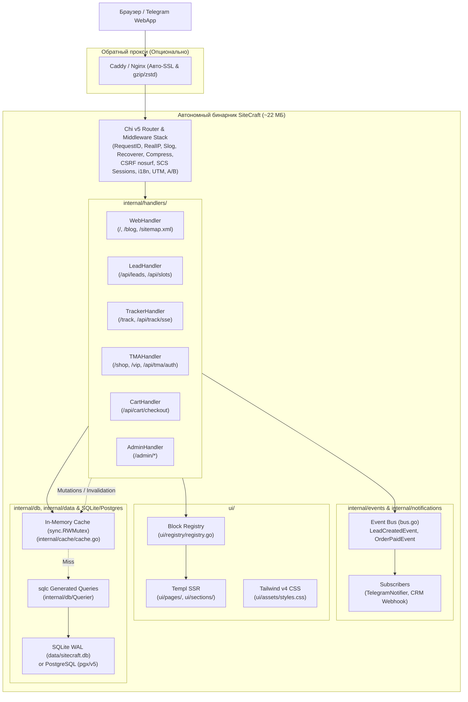
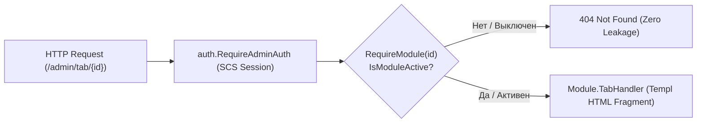

# ⚡ SiteCraft Engine — Архитектурная документация проекта

> **SiteCraft** — модульный масштабируемый движок и универсальный стартовый набор (Boilerplate / Starter Kit) для создания сверхбыстрых коммерческих сайтов, веб-приложений малого и среднего бизнеса (SMB), локальных сервисов и корпоративных порталов.
>
> **Стек:** Go 1.27 + Chi v5 + modernc/sqlite (PostgreSQL-ready) + sqlc + goose + scs + bimg + Templ + HTMX + Alpine.js + Tailwind CSS v4.3 (Oxide)  
> **Форм-фактор:** Single Binary (~22 МБ) • **RAM:** 15–25 МБ • **TTFB:** 0.8–3.5 мс • **PageSpeed:** 95–100/100

---

## 🗺 Быстрая навигация по задачам (Fast Map)

| Задача | Где лежит код | Основные файлы | Команда проверки |
|---|---|---|---|
| **Добавить UI-блок / секцию** | `ui/sections/`, `ui/components/` | `ui/registry/registry.go`, `ui/pages/` | `make check` |
| **Добавить HTTP-маршрут / API** | `internal/handlers/`, `internal/server/` | `internal/server/server.go` | `make test` |
| **Изменить стили / токены темы** | `ui/assets/` | `ui/assets/input.css` | `make generate` |
| **Добавить таблицу БД / миграцию**| `sql/migrations/` | `sql/migrations/sqlite/*.sql`, `sql/migrations/postgres/*.sql` | `sqlc generate && make test` |
| **Добавить / изменить SQL-запрос** | `sql/queries/` | `sql/queries/*.sql`, `internal/db/` | `sqlc generate && make test` |
| **Изменить бизнес-модель данных** | `internal/models/` | `internal/models/*.go` | `make test` |
| **Добавить/настроить пресет ниши** | `presets/` | `presets/*.json`, `internal/data/preset.go` | `make test` |
| **Запуск сервера с авто-перезагрузкой**| Корень | `.air.toml` | `make dev` |
| **Сборка бинарника для продакшена** | Корень | `main.go`, `Makefile` | `make build` |

---

## 📑 Содержание

1. [Ключевые характеристики](#1-ключевые-характеристики)
2. [Архитектура ядра и потоков данных](#2-архитектура-ядра-и-потоков-данных)
3. [Структура проекта](#3-структура-проекта)
4. [База данных, sqlc и миграции goose](#4-база-данных-sqlc-и-миграции-goose)
5. [Модели данных Go и безопасность](#5-модели-данных-go-и-безопасность)
6. [Карта маршрутов и API](#6-карта-маршрутов-и-api)
7. [In-Memory кэширование и реактивная инвалидация](#7-in-memory-кэширование-и-реактивная-инвалидация)
8. [Событийная шина и уведомления (Event-Driven)](#8-событийная-шина-и-уведомления-event-driven)
9. [Интернационализация (i18n)](#9-интернационализация-i18n)
10. [CSS-архитектура и Dynamic Theming Engine](#10-css-архитектура-и-dynamic-theming-engine)
11. [Реестр компонентов (Block Registry)](#11-реестр-компонентов-block-registry)
12. [Кинематографический UI (Zero-GSAP)](#12-кинематографический-ui-zero-gsap)
13. [Коммерческие бизнес-модули (20 модулей)](#13-коммерческие-бизнес-модули-20-модулей)
14. [Пресеты ниш и мультисайтовый оркестратор (Fleet)](#14-пресеты-ниш-и-мультисайтовый-оркестратор-fleet)
15. [Руководство разработчика: новые секции и безопасность](#15-руководство-разработчика-новые-секции-и-безопасность)
16. [Клиентский JS-рантайм и антипаттерны](#16-клиентский-js-рантайм-и-антипаттерны)
17. [Продакшен-эксплуатация, Observability и Watchdog](#17-продакшен-эксплуатация-observability-и-watchdog)
18. [Дорожная карта и планируемые улучшения (Roadmap)](#18-дорожная-карта-и-планируемые-улучшения-roadmap)

---

## 1. Ключевые характеристики

| Параметр | Значение | Описание |
|---|---|---|
| **Форм-фактор** | Single Binary (~25 МБ) | Веб-сервер, SQLite БД, админка `/_/`, шаблоны Templ и ассеты скомпилированы в один файл |
| **Потребление памяти** | **20–35 МБ RAM** | Позволяет запускать до 50 изолированных сайтов на одном базовом VPS ($10/мес) |
| **Время отклика (TTFB)** | **< 10 мс** | In-Memory кэш с блокировками чтения `sync.RWMutex` |
| **PageSpeed Insights** | **95–100 / 100** | Полное отсутствие тяжелой клиентской гидратации; CSS < 20 КБ; ленивая загрузка виджетов |
| **Пропускная способность** | **4 000 – 45 000+ RPS** | До 45k req/s на чтение (Templ + SQLite WAL) и 1 500 – 4 000 транзакций/сек на запись на NVMe |
| **Рантайм в продакшене** | **0 КБ Node.js / Python** | Стили и шаблоны компилируются заранее (`templ generate`, `tailwindcss --minify`) |
| **Доступность** | **ГОСТ Р 52872-2019** | Встроенный модуль для слабовидящих на нативном Vanilla JS (< 1.5 КБ) |
| **UI-примитивы** | Zero-Cost Go Variants (CVA) + Tailwind v4 Data-Variants + `Lucide` | 100% типобезопасные кнопки (`@base.Button`), бейджи (`@base.Badge`), карточки (`@base.Card`) |
| **Интерактивность** | HTMX + Alpine.js | Нативная связка `hx-alpine-compat` для динамических AJAX-свопов без конфликтов |

---

## 2. Архитектура ядра и потоков данных



---

## 3. Структура проекта

* `main.go` — Точка входа: инициализация Chi сервера, запуск миграций goose, фоновый планировщик, CLI-команды `apply-preset` и `export`.
* `Makefile` — Главный интерфейс команд для разработчика и ИИ-агента (`make check`, `make generate`, `make test`, `make build`, `make dev`).
* `sql/` — Хранилище SQL миграций и запросов:
  * `migrations/sqlite/` — ANSI/SQLite DDL миграции goose (`00001_init.sql`).
  * `migrations/postgres/` — PostgreSQL DDL миграции goose (`00001_init.sql`).
  * `queries/` — Типобезопасные SQL-запросы для sqlc (`pages.sql`, `leads.sql`, `services.sql`, `articles.sql`, `settings.sql`, etc.).
* `sqlc.yaml` — Конфигурация генератора sqlc (`engine: sqlite`, `emit_interface: true`, пакет `internal/db`).
* `AGENTS.md` — Иерархия DOX-контрактов для ИИ-агентов ([AGENTS.md](AGENTS.md), [internal/AGENTS.md](internal/AGENTS.md), [ui/AGENTS.md](ui/AGENTS.md), [deploy/AGENTS.md](deploy/AGENTS.md), [presets/AGENTS.md](presets/AGENTS.md)).
* `BUSINESS_MODULES.md` — Детальные спецификации 20 коммерческих модулей.
* `FLEET_ARCHITECTURE.md` — Спецификация мультисайтового оркестратора и скрипта `fleet.sh`.
* `internal/` — Бэкенд-ядро:
  * `auth/` — Сессии SCS, хэширование паролей bcrypt, middleware защиты `/admin`.
  * `cache/` — Потокобезопасный in-memory кэш (`sync.RWMutex`).
  * `data/` — Пресеты ниш (`preset.go`) и доменный репозиторий `sql_repository.go`.
  * `db/` — Драйвер SQLite/Postgres, запуск goose-миграций и sqlc-интерфейс `Querier`.
  * `events/` — Внутрипроцессная шина событий (`bus.go`, `events.go`).
  * `exporter/` — Статический генератор (SSG HTML/CSS).
  * `handlers/` — HTTP-хэндлеры Chi (web, leads, админка `/admin`, чат, корзина, трекер заказов, платежи, TMA).
  * `i18n/` — Интернационализация (словари RU/EN, плюрализация, middleware).
  * `media/` — Пайплайн обработки картинок (миниатюры, WebP/AVIF, кэширование).
  * `models/` — Доменные Go-структуры (`Lead`, `Service`, `Article`, `ServiceOrder`, `ReviewItem`, `ThemeConfig`).
  * `notifications/` — Telegram-бот нотификатор и CRM вебхуки.
  * `server/` — Корневой сервер Chi, стек middleware, маршрутизация, модульный реестр панели управления (`admin_registry.go`) и graceful shutdown.
* `ui/` — Фронтенд-слой:
  * `assets/` — CSS-first Tailwind v4 конфиг (`input.css`) и скомпилированный бандл (`styles.css`).
  * `components/base/` — Zero-cost CVA UI-примитивы (`Button`, `Badge`, `Card`).
  * `components/cinematic/` — 31 кинематографический UI-модуль без GSAP.
  * `layouts/` — Базовые HTML-шаблоны и SEO-генерация.
  * `pages/` — Полноэкранные страницы лендинга, блога, трекера, магазина, кастомной админки (`client_admin_*.templ`).
  * `registry/` — Реестр и фабрика динамических блоков (`registry.go`, `helpers.go`).
  * `sections/` — Секции лендинга (hero, booking, services, faq, quiz, etc.).
* `presets/` — 13 готовых конфигураций ниш SMB в формате JSON.
* `deploy/` — Скрипты развертывания, systemd-юниты, Caddy/Nginx конфиги, watchdog-мониторинг.

---

## 4. База данных, sqlc и миграции goose

Схема базы данных строго типизирована, хранится в виде ANSI SQL миграций goose (`sql/migrations/`) и компилируется в Go-код через `sqlc`. Поддерживается паттерн **Dual-Engine Ready** (SQLite по умолчанию, PostgreSQL для масштабирования):

| Таблица | Назначение | Ключевые поля |
|---|---|---|
| `site_settings` | Бренд, SEO, цветовая тема, контакты, реквизиты, 152-ФЗ | `id`, `site_name`, `theme_color`, `active_preset`, `meta_title`, `phone`, `email` |
| `site_content` | Главные заголовки, бейджи доверия, копирайт | `id`, `hero_title`, `hero_subtitle`, `trust_badges`, `footer_text` |
| `page_blocks` | Блочный конструктор секций страниц | `id`, `type`, `title`, `order_index`, `is_active`, `payload` (JSON) |
| `services` | Каталог услуг, прайс-лист, длительность, склад | `id`, `name`, `slug`, `price`, `duration_minutes`, `stock_count` |
| `leads` | Заявки с форм, запись на прием, UTM-атрибуция | `id`, `name`, `phone`, `email`, `status`, `utm_source`, `utm_campaign` |
| `articles` | Блог / SEO, отложенный постинг | `id`, `title`, `slug`, `content_html`, `meta_description`, `is_published`, `published_at` |
| `service_orders` | B2B-трекер заказов, этапы выполнения, смета | `id`, `order_number`, `client_phone`, `status`, `total_amount`, `steps` |
| `chat_messages` | Сообщения Live-чата Web-to-Telegram и SSE | `id`, `session_id`, `sender_type`, `text`, `tg_message_id` |
| `coupons` | Промокоды, скидки (фикс/процент), лимиты | `id`, `code`, `discount_type`, `discount_value`, `is_active` |
| `resources` | Персонал: мастера, специалисты, посты обслуживания | `id`, `name`, `role`, `specialization`, `avatar` |
| `reviews` | Проверенные отзывы клиентов с фото (Verified UGC) | `id`, `author_name`, `rating`, `comment`, `is_published`, `photos` |
| `branches` | География: филиалы, адреса, координаты для карт | `id`, `name`, `city`, `address`, `lat`, `lng`, `working_hours` |
| `vacancies` | HR-портал: открытые вакансии и требования | `id`, `title`, `department`, `salary`, `requirements`, `is_open` |
| `sessions` | Сессии авторизации администраторов (SCS Store) | `token`, `data`, `expiry` |

---

## 5. Модели данных Go и безопасность

Доменные структуры расположены в каталоге `internal/models/` и слое `internal/data/sql_repository.go`:
* `Lead` (`lead.go`) — Валидация телефонов по E.164, Honeypot-поле, санитизация через `bluemonday.UGCPolicy()`.
* `Service` (`service.go`) — Каталог услуг, складские остатки, длительность для слотов записи.
* `Article` (`article.go`) — Блог, время чтения, генерация OpenGraph / JSON-LD метаданных.
* `ServiceOrder` (`b2b.go`) — Трекинг заказа, история этапов, расчет стоимости с НДС.
* `ThemeConfig` (`theme.go`) — Палитра, радиус скруглений, темный режим, сезонные темы.

---

## 6. Карта маршрутов и API

Маршруты регистрируются в `internal/server/server.go`:

| Путь | Метод | Описание | Ответ / Своп |
|---|---|---|---|
| `/` | `GET` | Главная страница лендинга | HTML (Templ SSR) |
| `/blog`, `/blog/{slug}` | `GET` | Каталог статей и страница статьи | HTML (Templ SSR) |
| `/track` | `GET` | Трекер статуса заказа по номеру/телефону | HTML (Templ SSR) |
| `/api/track/sse` | `GET` | SSE-поток обновлений статуса заказа | Server-Sent Events |
| `/admin` | `GET` | Главная панель управления (сводка, метрики) | HTML (Templ SSR) |
| `/admin/login`, `/admin/logout` | `GET/POST`| Авторизация в админке с защитой от брутфорса | HTML / Редирект |
| `/admin/blocks` | `GET/POST`| Визуальный конструктор структуры блоков страниц | HTML / HTMX свопы |
| `/admin/leads` | `GET/POST`| Управление заявками (фильтрация, статусы, экспорт)| HTML / HTMX свопы |
| `/admin/media` | `GET/POST`| Медиатека (drag-and-drop загрузка, ресайз) | HTML / HTMX свопы |
| `/admin/settings` | `GET/POST`| Управление брендом, контактами, SEO и 152-ФЗ | HTML / HTMX свопы |
| `/media/{size}/{filename}` | `GET` | Раздача оптимизированных миниатюр (thumb, sm, md, lg)| Бинарный WebP/JPEG/PNG |
| `/api/leads` | `POST` | Прием заявки с валидацией и антиспамом | HTMX фрагмент подтверждения |
| `/api/slots` | `GET` | Доступные слоты бронирования по дате/мастеру | HTMX HTML-фрагмент |
| `/api/cart/*` | `POST` | Добавление в корзину, расчет доставки, промокод | JSON / HTMX корзины |
| `/api/payment/create` | `POST` | Создание платежной сессии (ЮKassa / Mock) | JSON с URL редиректа |
| `/api/chat/*` | `GET/POST`| Отправка сообщений и SSE-стриминг чата | SSE / JSON |
| `/api/review` | `POST` | Отправка отзыва с фотографиями | HTMX статус модерации |
| `/fleet/*` | `GET/POST`| Мультисайтовый пульт управления инстансами | HTML / JSON |
| `/sitemap.xml`, `/robots.txt` | `GET` | Динамические SEO-файлы | XML / Plain Text |

---

### 6.1 Модульная архитектура клиентской админ-панели (AdminModule Registry) и безопасность

Клиентский кабинет управления (`/admin`, `/client`) спроектирован по паттерну **Module Registry & Dynamic Tabs** с гарантией безопасности на уровне Go Middleware:



#### Архитектурные принципы:
1. **Единый контракт модуля (`AdminModule`):**
   Каждый раздел панели описывается изолированной структурой в [`internal/server/admin_registry.go`](file:///home/zerg/Projects/web/SiteCreator/internal/server/admin_registry.go):
   * `ID` — уникальный идентификатор (`leads`, `contacts`, `services`, `articles`, `reviews`, `security`, `fleet`).
   * `Title` — локализованное название для меню.
   * `Order` — вес сортировки в сайдбаре.
   * `IsEnabled` — предикат проверки активности (чтение флагов `SiteSettings.EnableBlog`, `EnableFleet`, `EnableCart`).
   * `Badge` — динамическая функция подсчета счетчиков (например, кол-во новых заявок).
   * `TabHandler` — HTTP-обработчик, возвращающий HTML-фрагмент для HTMX-свопа.
2. **Нулевая утечка информации (Defense-in-Depth):**
   * Если модуль отключен клиенту, доступ к нему блокируется через `s.RequireModule(id, handler)` и `s.RequireModuleGroup(id)`.
   * Запрос к отключенной вкладке возвращает **HTTP 404 Not Found**, исключая несанкционированное зондирование API и функционала.
   * Любые действия модуля (`POST /admin/articles/save`, `POST /admin/services/new` и т.д.) обернуты в middleware группы.
3. **Безопасный Fallback (`ResolveActiveTab`):**
   * Если пользователь обращается к дашборду по прямой закладке с отключенным модулем (`/admin?tab=articles` при `EnableBlog == false`), сервер автоматически выбирает первый доступный активный модуль (`leads` или `contacts`).
4. **Динамический UI без хардкода:**
   * В шаблоне [`ui/pages/client_admin.templ`](file:///home/zerg/Projects/web/SiteCreator/ui/pages/client_admin.templ) мобильный `<select>` и десктопный сайдбар `<nav>` рендерятся единым циклом по `modules []AdminTabModule`.
   * Для отключенных модулей кнопки физически отсутствуют в DOM-дереве.

---

## 7. In-Memory кэширование и реактивная инвалидация

* Реализация: `internal/cache/cache.go`.
* Блокировки: `sync.RWMutex` (параллельное чтение без блокировок, эксклюзивная запись).
* Инвалидация при мутациях: методы репозитория (`internal/data/sql_repository.go`) и хэндлеры админки автоматически сбрасывают ключи кэша (`site_data`, `articles_list`, `services_list`) в течение < 0.1 мс при сохранении изменений.

---

## 8. Событийная шина и уведомления (Event-Driven)

Внутрипроцессная шина (`internal/events/bus.go`) реализует паттерн Pub/Sub:
* **События:** `LeadCreatedEvent`, `OrderPaidEvent`, `ChatMessageEvent`, `ReviewSubmittedEvent`.
* **Подписчики (`internal/notifications/`):**
  * `TelegramNotifier` — Мгновенные пуши в рабочий Telegram-чат владельца с кнопками действий.
  * `WebhookNotifier` — Отправка JSON payload во внешние CRM (AmoCRM, Bitrix24, LeadKit).

---

## 9. Интернационализация (i18n)

* Реализация: `internal/i18n/`.
* Определение языка: URL-префикс (`/en/...`), кука `site_lang` или заголовок `Accept-Language`.
* Функции шаблонов: `i18n.T(lang, "key")`, `i18n.Plural(lang, count, "one", "few", "many")`.
* Нулевые аллокации при повторных переводах (каталог зашит в памяти).

---

## 10. CSS-архитектура и Dynamic Theming Engine

1. **Tailwind CSS v4 (Oxide):** Конфиг `ui/assets/input.css` построен на `@theme` директивах без `tailwind.config.js`. Компилируется в standalone-бинарнике через нативный CLI (`make generate`).
2. **Zero-Cost Go Variants (CVA):** Типобезопасные генераторы классов для компонентов (`ui/components/base/`):
   ```go
   @base.Button(base.ButtonProps{Variant: base.BtnPrimary, Size: base.BtnMd}) { Текст }
   ```
3. **Data-Variants:** Использование нативных `@custom-variant` (`data-open:`, `data-active:`), управляемых через Alpine.js без пересчета классов в JS.
4. **Панель доступности (ГОСТ Р 52872-2019):** Модуль для слабовидящих (`ui/components/a11y_bar.templ`) на нативном Vanilla JS: контрастность, изменение размера шрифта, выключение анимаций.

---

## 11. Реестр компонентов (Block Registry)

Фабрика `ui/registry/registry.go` динамически маппит типы блоков из коллекции `page_blocks` в скомпилированные Templ-секции:

| Тип блока | Компонент Templ | Назначение |
|---|---|---|
| `hero` | `ui/sections/hero/` | Первый экран (Split, Cinematic, Slider, Video) |
| `services` | `ui/sections/services.templ` | Сетка услуг с фильтрацией по категориям |
| `booking` | `ui/sections/booking.templ` | Интерактивный календарь и выбор слота записи |
| `faq` | `ui/sections/faq.templ` | Аккордеон частых вопросов с JSON-LD разметкой |
| `features` | `ui/sections/features.templ` | Преимущества и ключевые характеристики |
| `quiz` | `ui/sections/quiz.templ` | Квиз-опросник подбора услуги с лидогенерацией |
| `before_after` | `ui/sections/before_after.templ` | Слайдер сравнения «До / После» |
| `reviews` | `ui/sections/reviews.templ` | Карусель проверенных отзывов клиентов |
| `contacts` | `ui/sections/contacts.templ` | Форма связи, реквизиты, карта филиалов |
| `pricing` | `ui/sections/pricing.templ` | Тарифная сетка с переключателем периода |

---

## 12. Кинематографический UI (Zero-GSAP)

31 интерактивный модуль в `ui/components/cinematic/` (подробности в [ui/components/cinematic/AGENTS.md](ui/components/cinematic/AGENTS.md)):
* **Scroll-Driven (10 шт):** Скролл-прогресс, Parallax, Sticky Showcase, Scroll Velocity.
* **Cursor & Hover (8 шт):** 3D Tilt Card, Spotlight Glow, Magnetic Button, Morphing Shape.
* **Click & Tap (6 шт):** Ripple Effect, Expanding Card, Micro-Feedback.
* **Ambient & Auto (7 шт):** Mesh Gradients, Noise Canvas, Floating Badges, Marquee.

Все анимации оптимизированы под 60 FPS на GPU (`transform`, `opacity`) с поддержкой `prefers-reduced-motion`.

---

## 13. Коммерческие бизнес-модули (20 модулей)

Полные спецификации и API описаны в [BUSINESS_MODULES.md](BUSINESS_MODULES.md):

* **E-Commerce & Доставка:** Корзина (`CartDrawer`), расчет зон доставки, промокоды (`coupons`), счета-фактуры с QR-кодом, онлайн-оплата (ЮKassa / Mock).
* **Growth & CRO:** Серверные A/B тесты без мигания (`ab.go`), UTM-атрибуция (`utm.go`), Exit-Intent модалка удержания, Social Proof тосты недавней активности.
* **Booking & Лояльность:** Интерактивное бронирование слотов, генерация .ics календарей, отмена записи по токену, триггерные напоминания в Telegram.
* **B2B & Комплаенс:** Трекер статуса заказов в реальном времени (`/track`), интерактивная карта филиалов, карьерный HR-портал (`/careers`), согласие на cookies по 152-ФЗ.
* **Агентский пульт и TMA:** Telegram Mini App магазин (`/shop`, `/vip`), Web-to-Telegram живой чат, кабинет клиента (`/client`), мультисайтовый Fleet Dashboard.

---

## 14. Пресеты ниш и мультисайтовый оркестратор (Fleet)

* **Пресеты ниш B2B & B2C (`presets/*.json`):** 9 пресетов B2B (`b2b_*.json`) с фокусом на регламенты, метрики и сравнение; 5 пресетов B2C (`b2c_*.json`) с фокусом на визуальный ритм, квизы и корзину; комплексный тестовый стенд `test_all_modules.json`.
* **Оркестратор (`fleet.sh`):** Создание клиентских сайтов за секунду, автоматический сид пресета, изоляция портов и директорий `pb_data`, экспорт в статику, резервное копирование (подробности в [FLEET_ARCHITECTURE.md](FLEET_ARCHITECTURE.md)).

---

## 15. Руководство разработчика: новые секции и безопасность

### Как добавить новую секцию:
1. Создать шаблон секции: `ui/sections/my_block.templ`.
2. Зарегистрировать парсер payload (если нужен JSON) в `ui/registry/helpers.go`.
3. Добавить ветку `case "my_block":` в `ui/registry/registry.go`.
4. Запустить `make check`.

### Стандарты безопасности (Zero-Trust):
* **XSS:** Все пользовательские тексты и HTML очищаются через `bluemonday.UGCPolicy()`.
* **Антиспам:** Скрытое поле-ловушка Honeypot (`website_hp`) в формах + Rate Limiting по IP.
* **CSRF:** Проверка служебных заголовков `HX-Request`, токенов защиты `nosurf` и защищенных сессий SCS (`SameSite=Lax`, `HttpOnly`).
* **Пароли:** Хэширование паролей администратора через `bcrypt` (стоимость 12) с защитой от тайминг-атак.

---

## 16. Клиентский JS-рантайм и антипаттерны

* **Разрешенные библиотеки:** HTMX (AJAX-свопы), Alpine.js (микро-состояние интерфейса), Motion One / Web Animations API, Lucide Icons.
* **Запрещено:** Тяжелые фреймворки (React, Vue, Svelte), GSAP/Three.js (> 50 КБ), импорт внешних CDN-скриптов в обход локальных бандлов, jQuery.

---

## 17. Продакшен-эксплуатация, Observability и Watchdog

* **Кэширование заголовков (`internal/handlers/cache_control.go`):** Статика (`/assets/*`) кэшируется на 1 год (`immutable`), SSR-страницы — `private, no-cache`, закрытые панели — `no-store`.
* **Observability (`internal/handlers/observability.go`):** Структурированное JSON-логирование `log/slog`, учет latency, статус-кодов, IP-клиентов и совместимость со стримингом SSE.
* **Сторож (`deploy/monitoring/watchdog.sh`):** Мониторинг RAM, диска, CPU и авто-перезапуск службы при 0 МБ постоянного потребления RAM (запуск по cron).
* **Деплой:** Подробные инструкции, systemd-юниты и Caddyfile задокументированы в [deploy/AGENTS.md](deploy/AGENTS.md).

---

## 18. Дорожная карта и планируемые улучшения (Roadmap)

В данный раздел вынесены второстепенные задачи и идеи развития панели управления `/admin`:

1. **Расширенные SEO-настройки страниц и блога:**
   * Кастомный ввод Meta Title и Meta Description с визуальным счетчиком оптимальной длины символов (зеленый/красный бейдж).
   * Выбор кастомного Open Graph превью для социальных сетей (VK, Telegram) и настройка канонических URL.
2. **Аналитика и конверсии (Встроенный дэшборд):**
   * График динамики заявок по дням и неделям (SVG/HTML графики без внешних JS библиотек).
   * Разбивка конверсий по источникам UTM-меток (`utm_source`, `utm_campaign`).
3. **Пакетная обработка изображений:**
   * Фоновая оптимизация загруженных оригиналов и генерация формата AVIF в дополнение к WebP.
