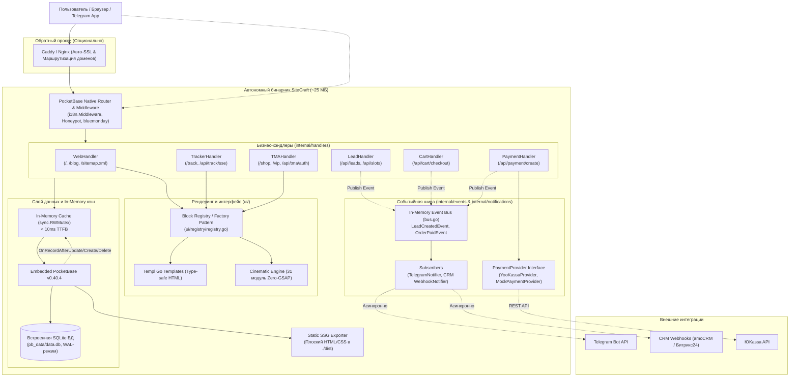

# ⚡ SiteCraft Engine — Генеральная документация проекта

> **SiteCraft** — модульный масштабируемый движок и универсальный стартовый набор (Boilerplate / Starter Kit) для создания сверхбыстрых коммерческих сайтов, веб-приложений малого и среднего бизнеса (SMB), локальных сервисов и корпоративных порталов.
>
> **Текущий стек:** Go 1.27 + PocketBase v0.40.4 + Templ + HTMX + Alpine.js + Tailwind CSS v4.3 (Oxide)  
> **Дата актуализации:** Октябрь 2026 г.

---

## 📑 Содержание

1. [Обзор и ключевые характеристики](#1-обзор-и-ключевые-характеристики)
2. [Архитектура ядра и потоков данных](#2-архитектура-ядра-и-потоков-данных)
3. [Структура проекта](#3-структура-проекта)
4. [База данных и схема коллекций PocketBase](#4-база-данных-и-схема-коллекций-pocketbase)
5. [Модели данных Go](#5-модели-данных-go)
6. [Карта маршрутов и API эндпоинтов](#6-карта-маршрутов-и-api-эндпоинтов)
7. [In-Memory кэширование и реактивные хуки](#7-in-memory-кэширование-и-реактивные-хуки)
8. [Событийная шина и уведомления (Event-Driven Architecture)](#8-событийная-шина-и-уведомления-event-driven-architecture)
9. [Модуль интернационализации (i18n RU / EN)](#9-модуль-интернационализации-i18n-ru--en)
10. [Динамический Theming Engine и CSS-архитектура](#10-динамический-theming-engine-и-css-архитектура)
11. [Реестр компонентов (Block Registry / Factory Pattern)](#11-реестр-компонентов-block-registry--factory-pattern)
12. [Коллекция кинематографических модулей (Cinematic UI — 31 компонент)](#12-коллекция-кинематографических-модулей-cinematic-ui--31-компонент)
13. [Коммерческие бизнес-модули (20 модулей)](#13-коммерческие-бизнес-модули-20-модулей)
14. [Каталог готовых пресетов и тестовых стендов](#14-каталог-готовых-пресетов-и-тестовых-стендов)
15. [CLI-утилиты и мультисайтовый оркестратор (Fleet of Binaries)](#15-cli-утилиты-и-мультисайтовый-оркестратор-fleet-of-binaries)
16. [Сборка, тестирование и продакшен-деплой](#16-сборка-тестирование-и-продакшен-деплой)
17. [Сравнение с аналогами и архитектурные компромиссы](#17-сравнение-с-аналогами-и-архитектурные-компромиссы)
18. [Руководство разработчика: добавление секций и безопасность](#18-руководство-разработчика-добавление-секций-и-безопасность)

---

## 1. Обзор и ключевые характеристики

| Параметр | Значение | Описание |
|---|---|---|
| **Форм-фактор** | Single Binary (~25 МБ) | Веб-сервер, SQLite БД, админка `/_/`, шаблоны Templ и ассеты скомпилированы в один файл |
| **Потребление памяти** | **20–35 МБ RAM** | Позволяет запускать до 50 изолированных сайтов на одном базовом VPS ($10/мес) |
| **Время отклика (TTFB)** | **< 10 мс** | In-Memory кэш с блокировками чтения `sync.RWMutex` |
| **PageSpeed Insights** | **95–100 / 100** | Полное отсутствие тяжелой клиентской гидратации; CSS < 20 КБ; ленивая загрузка виджетов |
| **Пропускная способность** | **4 000 – 45 000+ RPS** | До 45k req/s на чтение (Templ + SQLite WAL) и 1 500 – 4 000 транзакций/сек на запись на NVMe; до 250 000 одновременных пользователей онлайн |
| **Рантайм в продакшене** | **0 КБ Node.js / Python** | Стили и шаблоны компилируются заранее (`templ generate`, `tailwindcss --minify`) |
| **Доступность** | **ГОСТ Р 52872-2019** | Встроенный микро-модуль для слабовидящих на нативном Vanilla JS (< 1.5 КБ) |
| **UI-примитивы** | Zero-Cost Go Variants (CVA) + Tailwind v4 Data-Variants + `Lucide` | 100% типобезопасные кнопки (`@base.Button`), бейджи (`@base.Badge`), карточки (`@base.Card`) без аллокаций памяти и сырого SVG |
| **Интерактивность** | HTMX + Alpine.js | Нативная связка `hx-alpine-compat` для бесконфликтных динамических AJAX-свопов |

---

## 2. Архитектура ядра и потоков данных



---

## 3. Структура проекта

```
.
├── main.go                       # Точка входа: инициализация PB, фоновый Cron, CLI-команды apply-preset и export
├── go.mod / go.sum               # Модуль Go: PocketBase 0.40.4, Templ 0.3.1070, bluemonday, lucide
├── Dockerfile                    # Multi-stage сборка компактного дистрибутива Alpine Linux
├── docker-compose.yml            # Продакшен-контейнер с постоянным томом pb_data
├── fleet.sh                      # CLI-менеджер парка инстансов (создание, запуск, бэкап, экспорт)
├── init-project.sh               # Интерактивный визард создания нового проекта под нишу
├── BUSINESS_MODULES.md           # Реестр и спецификации 20 коммерческих модулей SiteCraft
├── internal/
│   ├── cache/
│   │   └── cache.go              # Потокобезопасный in-memory кэш (RWMutex) для настроек, контента и сущностей
│   ├── data/
│   │   ├── collections.go        # Инициализация и авто-миграции 13 коллекций PocketBase
│   │   ├── hooks.go              # Хуки инвалидации кэша при изменениях в админке
│   │   ├── preset.go             # Парсинг и применение JSON-пресетов ниш
│   │   ├── queries.go            # SQL-запросы и выборки данных с fallback-логикой
│   │   └── schema.go             # Корневой загрузчик схемы данных
│   ├── events/
│   │   ├── bus.go                # Потокобезопасная внутрипроцессная шина событий (sync.RWMutex)
│   │   ├── events.go             # Типы событий (LeadCreatedEvent, OrderPaidEvent)
│   │   └── bus_test.go           # Юнит-тесты событийной шины
│   ├── exporter/
│   │   ├── export.go             # Статический генератор (SSG): выгрузка сайта в плоский HTML/CSS
│   │   └── export_test.go        # Тестирование экспорта
│   ├── handlers/
│   │   ├── routes.go             # Регистрация HTTP-роутов PocketBase
│   │   ├── web.go                # Хэндлеры главной, блога, карты, слотов, документов и sitemap
│   │   ├── leads.go              # Прием заявок, валидация, honeypot, отклики HR, публикация событий
│   │   ├── cart.go               # Корзина, расчет зон доставки, промокоды (/api/cart/*)
│   │   ├── client_admin.go       # Личный кабинет владельца (/client): лиды, статьи, безопасность
│   │   ├── chat.go               # Live Web-to-TG чат с SSE и Telegram Bot мостом
│   │   ├── ab.go                 # Серверное A/B тестирование без мигания экрана (Zero-FOOC)
│   │   ├── utm.go                # Middleware сквозной UTM-атрибуции лидов
│   │   ├── calendar.go           # Генерация .ics календарей (RFC 5545) и отмена записей
│   │   ├── review.go             # Прием и модерация отзывов клиентов с фото
│   │   ├── fleet.go              # HTTP API и панель управления мультисайтовым флотом (/fleet)
│   │   ├── payment.go            # Интеграция с ЮKassa и Mock Sandbox
│   │   ├── tracker.go            # B2B-трекер заказов с SSE-стримингом и сервисной книжкой
│   │   ├── tma.go                # Telegram Mini App: HMAC-SHA256 авторизация, витрина, VIP-клуб
│   │   ├── validation.go         # Серверная валидация телефонов, email и капчи
│   │   └── *_test.go             # Набор интеграционных и юнит-тестов
│   ├── i18n/
│   │   ├── i18n.go               # Ядро локализации: нормализация, T(), Plural(), OGLocale()
│   │   ├── catalogs.go           # Словари терминов (навигация, доступность, формы, ошибки)
│   │   ├── middleware.go         # Router Middleware: авто-определение языка гостя
│   │   ├── handler.go            # Эндпоинт переключения языка (/api/lang/{code})
│   │   ├── localize.go           # Утилиты локализации динамических данных из БД
│   │   └── i18n_test.go          # Тесты системы i18n
│   ├── models/
│   │   ├── content.go            # Базовые структуры данных (SiteSettings, PageBlock, Lead, etc.)
│   │   ├── ecommerce.go          # Зоны доставки, сопутствующие товары (Cross-Sell), промокоды
│   │   ├── booking.go            # Специалисты/посты (Resource), бронирование с таймслотами
│   │   ├── chat.go               # Сообщения чата сайта (ChatMessage)
│   │   ├── review.go             # Отзывы клиентов с оценками и фото (ReviewItem)
│   │   ├── b2b.go                # Вакансии, филиалы, счета-фактуры с QR-кодом
│   │   ├── activity.go           # Деперсонализированные события недавней активности (Social Proof)
│   │   ├── fleet.go              # Метаданные инстансов парка сайтов (FleetInstance)
│   │   ├── seo.go                # SEO-структуры (MetaTags, OpenGraph, JSON-LD)
│   │   └── seo_test.go           # Тесты генерации метатегов
│   ├── modules/
│   │   └── payment.go            # Интерфейс PaymentProvider и реализация MockProvider
│   └── notifications/
│       ├── notifications.go      # Асинхронные нотификаторы (Telegram Bot, CRM Webhooks)
│       └── reminders.go          # Триггерные напоминания о визитах (Telegram + .ics вложения)
├── presets/                      # 13 готовых JSON-пресетов коммерческих ниш
├── public/                       # Статические медиа-файлы документации
└── ui/
    ├── embed.go                  # //go:embed ассетов и стилей в бинарник
    ├── assets/
    │   ├── input.css             # Tailwind v4 CSS-first конфиг (@theme директивы)
    │   ├── styles.css            # Скомпилированный минифицированный CSS (~15 КБ)
    │   └── css/                  # Модульные стили (tokens, shadcn, animations, a11y)
    ├── components/               # Примитивы интерфейса
    │   ├── base/                 # Zero-cost Go Variants (CVA UI-примитивы: Button, Badge, Card)
    │   │   ├── button.templ      # Кнопка с типизированными вариантами и размерами
    │   │   ├── badge.templ       # Бейджи со статусами и стилями
    │   │   ├── card.templ        # Карточки, заголовки и описания
    │   │   └── variants_test.go  # Модульные тесты генератора классов
    │   ├── a11y_bar.templ        # Панель для слабовидящих по ГОСТ (Vanilla JS)
    │   ├── cart_drawer.templ     # Выдвижная корзина (Alpine.js) с промокодами и зонами доставки
    │   ├── chat_widget.templ     # Всплывающий Web-to-TG чат с оператором
    │   ├── cookie_consent.templ  # Баннер согласия на обработку cookies по 152-ФЗ
    │   ├── exit_intent.templ     # Модальное окно удержания уходящих посетителей
    │   ├── recent_activity.templ # Тост недавних действий (Social Proof / FOMO)
    │   ├── dynamic_block.templ   # Рендерер rich_text/html с санитизацией bluemonday
    │   ├── floating_contact.templ# Мульти-мессенджер виджет (WhatsApp + Telegram)
    │   ├── footer.templ          # Настраиваемый подвал
    │   ├── header.templ          # Шапка с переключателем тем, i18n и a11y
    │   ├── payment.templ         # Модалка онлайн-оплаты
    │   ├── ui_showcase.templ     # Витрина Go Variants + Tailwind v4 CSS Data-Variants
    │   └── cinematic/            # 31 кинематографический модуль (Zero-GSAP)
    ├── layouts/
    │   ├── base.templ            # Корневой HTML-шаблон, инъекция тем, a11y, скрипты
    │   └── seo.go                # Рендеринг SEO-тегов в <head>
    ├── pages/                    # Страницы сайта (home, blog, tracker, shop, vip, client_admin, invoice, legal, careers, fleet)
    ├── registry/
    │   ├── registry.go           # Фабрика компонентов (Block Registry / Factory Pattern)
    │   ├── helpers.go            # Парсеры JSON payload блоков (Features, FAQ, Quiz, etc.)
    │   └── helpers_test.go       # Тесты парсеров payload
    └── sections/                 # Модульные секции лендинга (hero/, booking, services, careers, before_after, etc.)
```

---

## 4. База данных и схема коллекций PocketBase

PocketBase использует встраиваемую SQLite в режиме WAL (Write-Ahead Logging). Схема автоматически инициализируется и мигрирует при запуске (`internal/data/collections.go`):

### 1. `site_settings` (Синглтон настроек)
Хранит глобальную конфигурацию сайта:
* `site_name` (text, req), `tagline` (text)
* `theme` (text) — цветовая тема (`legal`, `medical`, `auto`, `beauty`, `cyber`, `main`, etc.)
* `primary_color`, `accent_color`, `background_color`, `font_family` — динамические токены брендинга
* `enable_a11y` (bool) — включение панели для слабовидящих по ГОСТ
* `enable_alpine` (bool) — подключение рантайма Alpine.js
* `enable_turnstile` (bool), `turnstile_site_key`, `turnstile_secret_key` — Cloudflare Turnstile
* `telegram_bot_token`, `telegram_chat_id`, `webhook_url` — уведомления о лидах
* `yandex_metrika_id` (text) — счетчик аналитики
* `map_mode` (text) — режим карты: `lazy` (HTMX revealed), `iframe`, `static`
* `booking_mode` (text) — режим записи: `simple` (имя + телефон), `slots` (сетка времени)
* `enable_payment` (bool), `payment_shop_id`, `payment_secret`, `payment_sandbox` (bool) — эквайринг
* `enable_blog` (bool) — модуль статей и базы знаний
* `enable_tma` (bool) — поддержка Telegram Mini Apps
* `enable_tracker` (bool) — B2B-трекер заказов
* `enable_i18n` (bool), `default_lang` (text: `ru` / `en`) — мультиязычность
* `enable_floating_contact` (bool), `whatsapp_phone`, `telegram_contact` — плавающий мессенджер
* `enable_cart` (bool) — выдвижная корзина заказов
* `header_variant`, `footer_variant` — варианты раскладки шапки и подвала
* `enable_live_chat` (bool) — встроенный Web-to-Telegram чат с посетителем
* `enable_fleet` (bool) — агентский пульт управления мультисайтовым флотом
* `enable_recent_activity` (bool) — виджет недавней активности (Social Proof / FOMO)
* `client_admin_password` (text) — устаревший открытый пароль клиентского кабинета (автомигрируется в хэш)
* `client_admin_password_hash` (text) — bcrypt-хэш пароля доступа в клиентский кабинет (`/client`)

### 2. `site_content` (Тексты и контакты)
* `hero_badge`, `hero_title`, `hero_subtitle`
* `owner_name`, `owner_title` (с обратной совместимостью с `notary_name`, `notary_title`)
* `phone1`, `phone2`, `work_hours`, `lunch_break`, `days_off`
* `address`, `address_sub`, `map_iframe`
* `photo` (file: png, jpeg, webp, svg, gif)

### 3. `page_blocks` (Модульный конструктор страниц)
Управляет набором и очередностью блоков главной страницы:
* `type` (text, req) — тип секции: `hero`, `cyber_hero`, `legal_hero`, `split_hero`, `schedule`, `services`, `booking`, `map`, `features`, `faq`, `steps`, `reviews`, `team`, `gallery`, `quiz`, `calculator`, `before_after`, `careers`, `showcase`, `rich_text`, `html`, `cinematic_*`
* `title` (text) — заголовок секции
* `content` (text) — сырой HTML или текст (санитизируется через bluemonday)
* `order` (int) — порядковый номер рендеринга на странице
* `active` (bool) — флаг видимости
* `payload` (json) — структурированные данные секции (шаги квиза, карточки features, FAQ)

### 4. `services` (Каталог услуг, прайс-лист и складской учет)
* `title` (text, req), `description` (text), `price` (text)
* `order` (int), `active` (bool)
* `stock_count` (int) — количество товара на складе (декрементируется при покупке)
* `is_preorder` (bool) — флаг работы «Под заказ» при исчерпании остатков

### 5. `leads` (Заявки клиентов и лидген)
* `name` (text, req), `phone` (text, req), `email` (text)
* `source` (text), `booking_date` (text), `booking_time` (text)
* `status` (text: `новая`, `в работе`, `завершена`, `отклонена`)
* `payload` (json) — произвольные нишевые поля (марка авто, VIN, смета квиза, состав корзины, отклики вакансий, мастер/пост, UTM-метки, A/B вариант)

### 6. `articles` (SEO-Блог, База знаний и новости)
* `title` (text, req), `slug` (text, req, unique)
* `excerpt` (text), `content` (editor)
* `cover_image` (file), `author_name` (text), `published_at` (text, формат `YYYY-MM-DD HH:MM` с поддержкой отложенной публикации)
* `is_published` (bool), `is_deleted` (bool, мягкое удаление в корзину), `deleted_at` (text, дата удаления)
* `views_count` (int), `seo_title` (text), `seo_description` (text), `tags` (text)

### 7. `service_orders` (B2B-трекер заказов в реальном времени)
* `order_code` (text, req, unique) — например, `SRV-4182`, `FIX-9021`
* `client_name` (text), `client_phone` (text)
* `item_title` (text, req) — например, «BMW X5 3.0d (х819ок123)»
* `current_stage` (text: `received`, `diagnostics`, `in_progress`, `ready`, `completed`)
* `total_amount` (number), `is_paid` (bool)
* `stages_history` (json) — массив объектов этапов `{stage, title, timestamp, comment, done}`
* `notes` (text)

### 8. `chat_messages` (Встроенный чат сайта Web-to-Telegram)
* `session_id` (text, req) — уникальный ID сессии посетителя (`chat_anon_*`)
* `sender` (text, req: `user` или `operator`)
* `message` (text, req) — текст сообщения
* `reply_to_id` (text) — ID сообщения в Telegram
* `is_read` (bool) — флаг прочтения

### 9. `coupons` (Промокоды, акции и скидки)
* `code` (text, req, unique) — промокод (например, `PROMO10`, `WELCOME500`)
* `discount_type` (text, req: `percent` или `fixed`)
* `discount_value` (number, req) — размер скидки (% или сумма в рублях)
* `min_order_amount` (number) — минимальный чек для применения скидки
* `max_uses` (int) — максимальное число активаций (0 = безлимитно)
* `used_count` (int) — текущее количество использований
* `is_active` (bool) — активность промокода
* `expires_at` (text) — дата истечения акции

### 10. `resources` (Специалисты, мастера и посты обслуживания)
* `name` (text, req) — имя мастера или название поста («Подъемник #1», «Доктор Смирнов»)
* `role` (text) — должность или специализация («Ведущий хирург», «Мастер-приемщик»)
* `avatar` (text) — фото специалиста
* `active` (bool) — доступность для записи
* `sort_order` (int) — порядок отображения в селекторе бронирования

### 11. `reviews` (Проверенные отзывы клиентов UGC)
* `author_name` (text, req) — имя клиента
* `author_avatar` (text) — аватар
* `rating` (int, req: 1..5) — оценка сервиса
* `text` (text, req) — текст отзыва
* `service_id` (text) — привязка к конкретной услуге
* `photos` (json) — массив прикрепленных фото выполненных работ
* `is_published` (bool) — модерация (публикация после проверки)
* `verified` (bool) — бейдж «Проверенный клиент / Заказ подтвержден»

### 12. `branches` (Интерактивная карта филиалов и офисов)
* `title` (text, req) — название филиала («Центральный офис», «Северный филиал»)
* `city` (text, req) — город («Москва», «Санкт-Петербург»)
* `address` (text, req) — фактический адрес
* `phone` (text), `work_hours` (text)
* `coordinates` (text) — координаты широты и долготы («55.751244, 37.618423»)
* `is_active` (bool), `sort_order` (int)

### 13. `vacancies` (Карьерный портал и вакансии / HR)
* `title` (text, req) — должность («Автомеханик-диагност», «Младший юрист»)
* `department` (text) — отдел («Сервисная зона», «Корпоративное право»)
* `salary` (text) — вилка оплаты («от 120 000 ₽»)
* `experience` (text) — требуемый стаж («от 2 лет»)
* `description` (text) — описание обязанностей
* `requirements` (json) — список требований
* `is_active` (bool), `sort_order` (int)

---

## 5. Модели данных Go

Все структуры строго типизированы в пакете `internal/models`:

* `SiteSettings` — отображение настроек сайта с поддержкой фиче-тогглов.
* `SiteContent` — контентные поля главной страницы и контакты.
* `PageBlock` — блок страницы с поддержкой гибкого поля `Payload map[string]interface{}`.
* `FeaturesPayload`, `FeatureItem` — структурированные преимущества.
* `FAQPayload`, `FAQItem` — вопросы и ответы с поддержкой аккордеона.
* `StepsPayload`, `StepItem` — этапы выполнения работ.
* `QuizPayload`, `QuizStep`, `QuizOption` — многошаговый интерактивный калькулятор с расчетом стоимости.
* `BeforeAfterPayload`, `BeforeAfterItem` — кейсы с фото «До / После», сметой материалов и этапами.
* `CartItem`, `CartCheckoutRequest` — товары в корзине, гео-зоны доставки и применение промокодов (`ecommerce.go`).
* `Coupon` — промокод со скидкой и валидацией минимального чека (`ecommerce.go`).
* `ResourceItem`, `BookingSlot` — персонал, посты обслуживания и таймслоты бронирования (`booking.go`).
* `ChatMessage` — сообщения живого Web-to-Telegram чата с SSE (`chat.go`).
* `ReviewItem` — проверенные отзывы клиентов с фото и оценками (`review.go`).
* `BranchItem`, `VacancyItem`, `InvoiceData` — филиалы сети, вакансии и данные счетов B2B (`b2b.go`).
* `ActivityEvent` — деперсонализированные события недавней активности по 152-ФЗ (`activity.go`).
* `FleetInstance` — карточка инстанса в панели мультисайтового парка (`fleet.go`).
* `Lead` — универсальная модель входящей заявки с UTM-метками и A/B вариантом.
* `ArticleItem` — статья блога с метатегами для поисковой оптимизации.
* `ServiceOrder`, `OrderStageHistory` — трекинг сервисного тикета и прогресс-бар.
* `TMAUser` — верифицированный пользователь Telegram WebApp.
* `SEOMetaTags` — метатеги OpenGraph, Twitter Cards, Canonical, Alternate Hreflang и JSON-LD schema.

---

## 6. Карта маршрутов и API эндпоинтов

Все маршруты регистрируются на нативном роутере PocketBase в `internal/handlers/routes.go`:

| Метод | Путь | Хэндлер | Назначение | Формат ответа |
|---|---|---|---|---|
| `GET` | `/assets/{path...}` | `apis.Static` | Раздача статики (встроенная FS `ui.AssetsFS()`) | Binary / CSS / Images |
| `GET` | `/` | `webHandler.HandleHome` | Главная страница сайта (SSR Templ + Cache) | HTML (Text/html) |
| `GET` | `/blog` | `webHandler.HandleBlogList` | Каталог статей блога с живым HTMX-поиском | HTML |
| `GET` | `/blog/{slug}` | `webHandler.HandleBlogPost` | Страница статьи с инкрементом просмотров | HTML |
| `GET` | `/sitemap.xml` | `webHandler.HandleSitemap` | Динамическая XML-карта сайта для поисковиков | XML (application/xml) |
| `GET` | `/track` | `trackerHandler.HandleTrackerPage` | Поиск статуса заказа по номеру квитанции | HTML |
| `GET` | `/track/{code}` | `trackerHandler.HandleTrackOrder` | Карточка заказа, этапы, электронная сервисная книжка | HTML |
| `GET` | `/api/track/status/{code}` | `trackerHandler.HandleTrackStatusPartial` | HTMX-парциал карточки заказа для поллинга | HTML Partial |
| `GET` | `/api/track/sse/{code}` | `trackerHandler.HandleTrackSSE` | Серверный поток событий заказа (SSE) | SSE (text/event-stream) |
| `GET` | `/privacy` | `webHandler.HandlePrivacy` | Политика конфиденциальности по 152-ФЗ | HTML |
| `GET` | `/terms` | `webHandler.HandleTerms` | Пользовательское соглашение и оферта | HTML |
| `GET` | `/careers` | `webHandler.HandleCareers` | Карьерный портал и каталог вакансий | HTML |
| `GET` | `/invoice/{code}` | `webHandler.HandleInvoice` | B2B-счет и акт с ГОСТ QR-кодом для печати | HTML Print |
| `GET` | `/shop` | `tmaHandler.HandleShop` | Telegram Mini App каталог с MainButton | HTML |
| `GET` | `/vip` | `tmaHandler.HandleVIPClub` | Закрытый VIP-клуб с проверкой доступа | HTML |
| `POST` | `/api/tma/auth` | `tmaHandler.HandleTMAAuth` | HMAC-SHA256 авторизация сессии Telegram | JSON |
| `POST` | `/api/shop/checkout` | `tmaHandler.HandleShopCheckout` | Быстрый заказ через Telegram WebApp | JSON |
| `GET` | `/api/map-frame` | `webHandler.HandleMapFrame` | Ленивая загрузка интерактивной карты (HTMX) | HTML Partial |
| `GET` | `/api/slots` | `webHandler.HandleSlots` | Проверка свободных/занятых слотов времени | HTML Partial |
| `GET` | `/api/resources` | `webHandler.HandleResources` | Список доступных мастеров и постов обслуживания | HTML Partial |
| `GET` | `/api/branches` | `webHandler.HandleBranches` | Выборка филиалов и адресов сети | HTML Partial |
| `GET` | `/api/booking/calendar.ics`| `bookingHandler.HandleDownloadICS` | Скачивание календарного файла визита (RFC 5545)| text/calendar |
| `GET` | `/api/booking/action` | `bookingHandler.HandleBookingAction` | Отмена или подтверждение записи из письма | HTML Partial |
| `GET` | `/api/payment/modal` | `webHandler.HandlePaymentModal` | Модальное окно выбора способа оплаты | HTML Partial |
| `GET` | `/api/recent-activity` | `webHandler.HandleRecentActivity` | Деперсонализированные события FOMO (кэш 5 мин)| JSON / HTML Partial |
| `POST` | `/api/leads` | `leadHandler.HandleCreateLead` | Отправка заявки (с Honeypot, UTM, A/B и капчей)| HTML Partial |
| `POST` | `/api/careers/apply` | `leadHandler.HandleApplyVacancy` | Отклик на вакансию с резюме | HTML Partial |
| `POST` | `/api/reviews` | `reviewHandler.HandleSubmitReview` | Отправка клиентского отзыва с фото | HTML Partial |
| `POST` | `/api/cart/checkout` | `cartHandler.HandleCheckout` | Оформление заказа корзины с учетом зоны доставки | JSON / HTML |
| `POST` | `/api/cart/validate-coupon`| `cartHandler.HandleValidateCoupon` | Проверка и расчет скидки промокода | JSON / HTML Partial |
| `POST` | `/api/payment/create` | `paymentHandler.HandleCreatePayment` | Инициализация платежа ЮKassa / Mock Sandbox | JSON |
| `GET` | `/api/chat/sse` | `chatHandler.HandleChatSSE` | SSE-поток входящих сообщений чата сайта | SSE (text/event-stream) |
| `GET` | `/api/chat/history` | `chatHandler.HandleChatHistory` | История переписки для текущей сессии | JSON |
| `POST` | `/api/chat/send` | `chatHandler.HandleSendMessage` | Отправка сообщения в чат и релей в Telegram | JSON / HTML Partial |
| `POST` | `/api/chat/telegram-webhook`| `chatHandler.HandleTelegramWebhook`| Вебхук ответов оператора из Telegram-бота | JSON |
| `GET` | `/fleet` | `fleetHandler.HandleDashboard` | Пульт управления парком инстансов (Fleet Master)| HTML |
| `POST` | `/api/fleet/action` | `fleetHandler.HandleFleetAction` | Действия над инстансом (start/stop/restart/backup)| JSON |
| `POST` | `/api/fleet/create` | `fleetHandler.HandleFleetCreate` | Создание нового инстанса сайта из веб-панели | JSON |
| `GET` | `/api/lang/{code}` | `i18n.HandleSetLang` | Переключение языка с установкой cookie и редиректом | HTTP 302 Redirect |
| `GET` | `/client/login` | `clientAdminHandler.HandleLoginPage` | Форма входа в клиентский кабинет | HTML |
| `POST` | `/client/login` | `clientAdminHandler.HandleLogin` | Аутентификация с bcrypt и защитой от брутфорса | HTTP 302 Redirect / HTML |
| `POST` | `/client/setup` | `clientAdminHandler.HandleInitialSetup` | Первичная установка мастер-пароля (Setup Wizard) | HTTP 302 Redirect / HTML |
| `GET` | `/client/logout` | `clientAdminHandler.HandleLogout` | Выход из системы и аннулирование сессии | HTTP 302 Redirect |
| `GET` | `/client` | `clientAdminHandler.HandleDashboard` | Главный дашборд клиентского кабинета | HTML |
| `GET` | `/client/tab/leads` | `clientAdminHandler.HandleTabLeads` | Вкладка лидов с фильтрацией, сменой статуса, UTM | HTML Partial |
| `GET` | `/client/tab/contacts` | `clientAdminHandler.HandleTabContacts` | Вкладка контактов, соцсетей и реквизитов | HTML Partial |
| `GET` | `/client/tab/articles` | `clientAdminHandler.HandleTabArticles` | Вкладка управления блогом и корзиной статей | HTML Partial |
| `GET` | `/client/tab/security` | `clientAdminHandler.HandleTabSecurity` | Вкладка смены мастер-пароля доступа | HTML Partial |
| `GET` | `/client/tab/reviews` | `clientAdminHandler.HandleTabReviews` | Вкладка модерации отзывов клиентов | HTML Partial |
| `GET` | `/client/tab/fleet` | `fleetHandler.HandleTabFleet` | Вкладка управления мультисайтовым флотом | HTML Partial |
| `POST` | `/client/security/password` | `clientAdminHandler.HandleChangePassword` | Смена пароля с проверкой старого | HTML Partial |
| `POST` | `/client/contacts` | `clientAdminHandler.HandleSaveContacts` | Сохранение контактных данных сайта | HTML Partial |
| `POST` | `/client/leads/{id}/status` | `clientAdminHandler.HandleUpdateLeadStatus` | Мгновенная смена статуса заявки в 1 клик | HTML Partial |
| `GET` | `/client/export/leads.csv` | `clientAdminHandler.HandleExportLeadsCSV` | Экспорт базы входящих заявок в CSV | CSV (text/csv) |
| `POST` | `/client/articles/save` | `clientAdminHandler.HandleSaveArticle` | Сохранение статьи с обложкой и датой публикации | HTML Partial |
| `POST` | `/client/articles/toggle/{id}` | `clientAdminHandler.HandleToggleArticlePublish` | Переключение публикации статьи в 1 клик | HTML Partial |
| `POST` | `/client/articles/trash/{id}` | `clientAdminHandler.HandleTrashArticle` | Мягкое перемещение статьи в Корзину | HTML Partial |
| `POST` | `/client/articles/restore/{id}` | `clientAdminHandler.HandleRestoreArticle` | Восстановление статьи из Корзины | HTML Partial |
| `DELETE` | `/client/articles/permanent/{id}` | `clientAdminHandler.HandlePermanentDeleteArticle` | Окончательное безвозвратное удаление статьи | HTML Partial |
| `POST` | `/client/articles/trash/empty` | `clientAdminHandler.HandleEmptyTrash` | Полная очистка Корзины удаленных статей | HTML Partial |
| `POST` | `/client/reviews/{id}/toggle` | `reviewHandler.HandleTogglePublish` | Модерация отзыва: публикация / скрытие | HTML Partial |
| `DELETE` | `/client/reviews/{id}` | `reviewHandler.HandleDeleteReview` | Удаление отзыва клиента | HTML Partial |

---

## 7. In-Memory кэширование и реактивные хуки

Для достижения отклика **TTFB < 10 мс** запросы не обращаются к диску на каждое открытие страницы:

1. **Кэш-хранилище (`internal/cache/cache.go`):**  
   Использует потокобезопасную структуру со счетчиками и блокировками `sync.RWMutex`:
   * Кэш настроек `site_settings`
   * Кэш контента `site_content`
   * Кэш каталога `services`
   * Кэш блоков страницы `page_blocks`
   * Кэш статей `articles`
2. **Автоматическая реактивная инвалидация (`internal/data/hooks.go`):**  
   Подписана на события ядра PocketBase:
   ```go
   collections := []string{"site_settings", "site_content", "services", "page_blocks", "articles"}
   app.OnRecordAfterCreateSuccess(collections...).BindFunc(...)
   app.OnRecordAfterUpdateSuccess(collections...).BindFunc(...)
   app.OnRecordAfterDeleteSuccess(collections...).BindFunc(...)
   ```
   Любое сохранение в админ-панели мгновенно и точечно сбрасывает соответствующий срез кэша.
3. **Время выборки настроек:** **0 мс (O(1) чтение из RAM)**.

---

## 8. Собтийная шина и уведомления (Event-Driven Architecture)

Для исключения жесткой связанности бизнес-хэндлеры не вызывают внешние сервисы напрямую:

1. **Внутрипроцессная шина (`internal/events/bus.go`):**
   * Потокобезопасная публикация событий через интерфейс `EventBus`.
   * Типы событий: `LeadCreatedEvent` (создание заявки/записи), `OrderPaidEvent` (успешная онлайн-оплата заказа).
2. **Подписчики (`internal/notifications/notifications.go`):**
   * **Telegram Notifier:** формирует форматированное HTML-сообщение в Telegram-чат администратора с полным составом полей `payload`.
   * **CRM Webhook Notifier:** выполняет асинхронный POST-запрос с JSON-телом заявки на внешний URL (amoCRM, Битрикс24, n8n, Make).
   * **Композитный паттерн (`CompositeNotifier`):** позволяет объединять произвольное число каналов уведомлений без блокировки HTTP-ответа посетителю.
3. **Платежный провайдер (`internal/modules/payment.go`):**
   * Интерфейс `PaymentProvider` с методами `CreatePayment` и `GetPaymentStatus`.
   * Поддержка продакшен REST API ЮKassa и встроенного Mock/Sandbox провайдера для локальной разработки и тестирования без денег.

---

## 9. Модуль интернационализации (i18n RU / EN)

Пакет `internal/i18n` обеспечивает полноценную двуязычную локализацию без внешних JS-зависимостей:

1. **Каскадный Fallback определения языка:**
   * GET-параметр запроса: `?lang=en` или `?lang=ru` (высший приоритет, сразу обновляет Cookie).
   * Браузерная Cookie: `site_lang` (срок жизни 1 год).
   * HTTP-заголовок браузера: `Accept-Language`.
   * Дефолтный язык сайта из настроек `site_settings.default_lang` (по умолчанию `ru`).
2. **Zero-JS переключатель языков:**  
   В шапку (`ui/components/header.templ`) встроен компонент `LanguageSwitcher()`, работающий как чистые ссылки на эндпоинт `/api/lang/{code}` с возвратом на исходную страницу по заголовку `Referer`.
3. **Каталоги терминов (`internal/i18n/catalogs.go`):**  
   Семантические ключи охватывают навигацию (`nav.*`), темы оформления (`theme.*`), доступность (`a11y.*`), кнопки (`btn.*`), бронирование (`booking.*`), трекер (`tracker.*`), блог (`blog.*`) и сообщения валидации форм.
4. **Правила плюрализации:**  
   Функция `i18n.Plural(ctx, count, one, few, many)` с корректной грамматикой для русского (1 день, 2 дня, 5 дней) и английского языков.
5. **SEO-интернационализация:**  
   Динамический тег `<html lang="...">`, OpenGraph `og:locale` (`ru_RU` / `en_US`) и теги поисковой оптимизации `<link rel="alternate" hreflang="...">`.

---

## 10. Динамический Theming Engine и CSS-архитектура

### 1. Архитектура Tailwind CSS v4 (Oxide) & CSS-first конфиг
* **Чистый CSS-first конфиг:** Все директивы и токены задаются в [input.css](ui/assets/input.css) через `@theme`. Файл `tailwind.config.js` полностью устранен.
* **Автоматическое сканирование:** `@source "../**/*.templ"` обеспечивает сборку только используемых утилит напрямую компилятором Oxide без JavaScript-рантайма.
* **CSS Color Level 4:** Использование нативной функции браузера `color-mix()` для расчета теней, hover-состояний и приглушенных поверхностей.
* **Ликвидация устаревшего `@apply`:** Избыточные служебные классы-мосты (`.cn-button*`, `.cn-badge*`) удалены из [components.css](ui/assets/css/components.css). Стилизация примитивов перенесена непосредственно в скомпилированные Go-шаблоны.

### 2. Паттерн Zero-Cost Go Variants (CVA-архитектура в Go)
Для базовых компонентов пользовательского интерфейса реализован легковесный паттерн Variants (аналог CVA / Class Variance Authority из экосистемы React) в пакете `ui/components/base/`:

* **Строгая типизация вариантов и размеров:**
  * Кнопки (`base.ButtonProps`): `Variant` (`BtnPrimary`, `BtnSecondary`, `BtnAccent`, `BtnOutline`, `BtnGhost`, `BtnDestructive`), `Size` (`BtnSizeDefault`, `BtnSizeXs`, `BtnSizeSm`, `BtnSizeLg`, `BtnSizeIcon`), полиморфный рендеринг (`<button>` или `<a>` при наличии `Href`).
  * Бейджи (`base.BadgeProps`): `Variant` (`BadgeDefault`, `BadgeSecondary`, `BadgeAccent`, `BadgeOutline`, `BadgeDestructive`), `Size` (`BadgeSizeDefault`, `BadgeSizeSm`, `BadgeSizeLg`).
  * Карточки (`base.CardProps`): `Variant` (`CardBase`, `CardInteractive`, `CardSm`, `CardMuted`), подкомпоненты `CardTitle` и `CardDescription`.
* **Стратегия нулевых аллокаций (Zero Heap Allocations):**
  Метод `Classes()` использует скомпилированный `switch-case` с полными строковыми литералами (что гарантирует обнаружение классов JIT-сканером Tailwind Oxide). Если кастомный оверрайд `Class == ""` (в 90% сценариев), функция конкатенирует константные строки напрямую без вызова парсера классов:
  ```go
  // Zero-allocation путь
  if p.Class == "" {
      return base + " " + variant + " " + size
  }
  // Вызов twmerge только при необходимости переопределения
  return twmerge.Merge(base, variant, size, p.Class)
  ```
* **Безопасное переопределение через `tailwind-merge-go`:** Передача классов вида `Class: "mt-4 w-full"` корректно заменяет конфликтующие паддинги и ширину базового компонента без поломки остальной верстки.

### 3. Нативные Tailwind v4 CSS Data-Variants (`@custom-variant`) & Alpine.js
Для управления динамическими состояниями страницы (открытие/закрытие модалок, табов, дропдаунов) вместо тяжелых JavaScript-библиотек или подмены классов (`classList.add/remove`) задействованы нативные директивы Tailwind v4 в [shadcn.css](ui/assets/css/shadcn.css):

```css
@custom-variant data-open (&:where([data-state="open"]));
@custom-variant data-closed (&:where([data-state="closed"]));
@custom-variant data-active (&:where([data-active="true"]), &:where([data-state="active"]));
@custom-variant data-checked (&:where([data-state="checked"]));
```

* **Бесшовная интеграция с Alpine.js:** Alpine мутирует только атрибуты `:data-state="isOpen ? 'open' : 'closed'` или `:data-active="isActive ? 'true' : 'false'`.
* **Аппаратные CSS-переходы:** Вся анимация и трансформация (`data-closed:opacity-0 data-open:opacity-100`, `data-active:bg-accent/15`) рассчитываются CSS-движком браузера с аппаратным GPU-ускорением.

### 4. Управление из админки PocketBase (`site_settings`)
При изменении `primary_color`, `accent_color`, `background_color` или `font_family` в `site_settings`, движок генерирует inline `:root` стили в `<head>`, мгновенно меняя бренд сайта без перекомпиляции CSS.

### 5. Сезонные темы и режим День / Ночь
Интерактивный переключатель в шапке сайта поддерживает:
* Базовые темы: `main`, `spring`, `summer`, `autumn`, `winter`.
* Вычисляемая математическая гармония: `harmonic` / `harmonic-night`.
* Светлый и темный режимы для каждой темы (`-day` / `-night`).
* Специальный режим для людей с особенностями цветовосприятия (`colorblind`).

### 6. Панель доступности (ГОСТ Р 52872-2019)
Микро-модуль на нативном Vanilla JS (< 1.5 КБ) в `ui/components/a11y_bar.templ`:
* 3 размера шрифта (`normal`, `large`, `xlarge`).
* 3 контрастные схемы (`black-on-white`, `white-on-black`, `blue-on-cyan`).
* Увеличение кернинга (межбуквенного интервала).
* Отключение фоновых картинок и тяжелых анимаций.

---

## 11. Реестр компонентов (Block Registry / Factory Pattern)

Диспетчеризация секций страницы вынесена в расширяемую фабрику `ui/registry/registry.go`:

```go
type BlockRenderer func(block models.PageBlock, ctx RenderContext) templ.Component

// Регистрация кастомного блока
registry.RegisterBlock("custom_block", func(b models.PageBlock, ctx registry.RenderContext) templ.Component {
    return MyCustomBlock(b.Payload)
})
```

### Встроенные типы блоков:
* `hero` — Главный экран с автоматическим выбором варианта (`classic`, `split`, `legal`, `cyber`).
* `cyber_hero`, `legal_hero`, `split_hero` — Явные варианты главного экрана.
* `schedule` — Контактная плашка с часами работы и телефонами.
* `services` — Сетка услуг с кнопками онлайн-записи и онлайн-оплаты.
* `booking` — Форма лидгена (простая или календарь с временными слотами).
* `features` — Сетка преимуществ с типобезопасными иконками Lucide.
* `team` — Карточки специалистов и врачей.
* `steps` — Пошаговый алгоритм работы (воронка доверия).
* `reviews` — Сетка отзывов клиентов с рейтингом.
* `faq` — Аккордеон часто задаваемых вопросов.
* `gallery` — Визуальная галерея работ и портфолио.
* `map` — Интерактивная карта (Яндекс Карты) с ленивой подгрузкой при прокрутке.
* `quiz` / `calculator` — Интерактивный опросник с расчетом сметы.
* `before_after` / `comparison` — Слайдер визуального сравнения результатов.
* `showcase` — Витрина Go Variants + Tailwind v4 CSS Data-Variants.
* `cinematic_*` — Модули кинематографической коллекции.
* `rich_text` / `html` — Произвольный HTML с очисткой через `bluemonday.UGCPolicy()`.

---

## 12. Коллекция кинематографических модулей (Cinematic UI — 31 компонент)

В директории `ui/components/cinematic/` собрана полная коллекция из **31 кинематографического компонента**, работающих по архитектуре **Zero-GSAP** (0 КБ сторонних тяжелых библиотек, нативный CSS + легкий Motion One < 4 КБ):

### 1. Scroll-Driven модули (10 компонентов)
1. `text_mask.templ` — Субпиксельный скраббинг маски текста.
2. `sticky_stack.templ` — Прилипающие карточки с IntersectionObserver.
3. `zoom_parallax.templ` — 3D-зум параллакс с разлетом элементов.
4. `horizontal_scroll.templ` — Плавный перевод вертикального скролла в горизонталь.
5. `continuous_scrub.templ` — Непрерывный скраббинг карточки и временной шкалы.
6. `sticky_cards.templ` — Стопка прилипающих карточек на чистом CSS.
7. `svg_draw.templ` — Анимация отрисовки векторного контура при прокрутке.
8. `curtain_reveal.templ` — Раздвигающиеся створки шторки (100dvh).
9. `split_scroll.templ` — Разнонаправленный скролл левой и правой колонок.
10. `color_shift.templ` — Динамическая смена темы оформления при скролле к секции.

### 2. Cursor & Hover модули (8 компонентов)
11. `cursor_reactive.templ` — 3D-наклон карточки (Tilt) и магнитная кнопка.
12. `accordion_slider.templ` — Горизонтальный аккордеон на чистом CSS flex.
13. `image_reveal.templ` — Слайдер сравнения «До / После».
14. `image_trail.templ` — Шлейф всплывающих карточек за курсором.
15. `flip_cards.templ` — 3D-переворот карточек на чистом CSS.
16. `magnetic_grid.templ` — Плитки сетки, отталкивающиеся от курсора мыши.
17. `spotlight_border.templ` — Радиальная световая подсветка границ карточек.
18. `drag_pan.templ` — Перетаскиваемый холст (Miro/Figma style).

### 3. Click & Tap модули (6 компонентов)
19. `view_transitions.templ` — Морфинг карточки в модальное окно через View Transition API.
20. `particle_button.templ` — Салют искр на Canvas при клике по кнопке.
21. `odometer.templ` — Накат цифр счетчика при появлении во вьюпорте.
22. `coverflow.templ` — Apple Coverflow карусель с 3D-перспективой.
23. `dynamic_island.templ` — Морфинг плашки уведомлений на Alpine.js.
24. `dock_nav.templ` — macOS Dock с плавным увеличением иконок при наведении.

### 4. Ambient & Auto модули (7 компонентов)
25. `text_scramble.templ` — Эффект декодирования символов («Матрица») на RAF.
26. `kinetic_marquee.templ` — Бесконечная бегущая строка с GPU-ускорением.
27. `mesh_gradient.templ` — Живой фон с плавающими цветными орбами.
28. `circular_text.templ` — Текст, непрерывно вращающийся по окружности вокруг иконки.
29. `glitch_text.templ` — Киберпанк RGB-глитч текста на чистом CSS.
30. `typewriter.templ` — Эффект печатающегося текста с мигающей кареткой.
31. `gradient_stroke.templ` — Контурный текст с бегущим градиентом.

---

## 13. Коммерческие бизнес-модули (20 модулей)

SiteCraft включает 20 готовых к продакшену бизнес-модулей, объединенных концепцией **Zero-SMS** ($0 расходов на сторонние шлюзы через связку Telegram Bot API + SMTP Magic Links + QR-коды) и **Zero-Node.js**:

### 📦 Блок 1. Электронная коммерция, Доставка и Склад (E-Commerce)

1. **Модуль зон доставки и гео-тарифов (`cart_drawer.templ`, `internal/handlers/cart.go`):**
   * Переключатель «Курьер / Самовывоз».
   * Расчет тарифов по зонам («По городу» — 300 ₽ / бесплатно от 2 500 ₽, «Пригород» — 650 ₽, «Область» — 1 200 ₽).
   * Динамический пересчет итогового чека в Alpine.js и фиксация зон в `service_orders` и `leads`.
2. **Модуль сопутствующих продаж Cross-Sell / Up-Sell (`cart_drawer.templ`, `internal/models/ecommerce.go`):**
   * Блок «Рекомендуем добавить к заказу» прямо в Drawer-корзине.
   * Добавление сопутствующих опций (экспресс-выезд, расширенная гарантия 1 год) в 1 клик через Alpine Store без сетевых задержек.
3. **Легковесный складской учет и остатки Simple Inventory (`internal/data/collections.go`, `services.templ`):**
   * Поля `stock_count` и `is_preorder` в коллекции `services`.
   * Автоматическое списание остатка при оформлении заказа в `cart.go`.
   * При остатке 0 товар автоматически переходит в статус «Под заказ», а при запасе <= 5 выводится FOMO-бейдж «Осталось всего X шт!».
4. **Система промокодов и акций Promo Engine (`internal/data/collections.go`, `/api/cart/validate-coupon`):**
   * Коллекция `coupons` со скидками (процентными и фиксированными), валидацией срока действия и лимита активаций (`max_uses`, `used_count`).
   * Мгновенная проверка по HTMX без перезагрузки, учет счетчика использований при оформлении чекаута. Демо-коды: `PROMO10` (10%) и `WELCOME500` (500 ₽).
5. **Интерактивная веб-корзина Web Cart Drawer (`ui/components/cart_drawer.templ`):**
   * Выдвижная корзина на Alpine.js со счетчиками количества, расчетом доставки и скидок. Оформление через `/api/cart/checkout`.
6. **Telegram Mini Apps (TMA) & VIP-клуб (`/shop`, `/vip`):**
   * HMAC-SHA256 авторизация сессии Telegram (`/api/tma/auth`), нативная поддержка MainButton и пейволл закрытого сообщества.

### 🎯 Блок 2. Маркетинг, Лидогенерация и Рост конверсии (Growth & CRO)

7. **Смарт-квиз и Интерактивный калькулятор сметы (`ui/sections/quiz.templ`, `internal/handlers/leads.go`):**
   * 3–4 пошаговых экрана с радиокнопками/опциями, наглядный прогресс-бар, мгновенный расчет суммы на клиенте без запросов к серверу, выбор канала связи (Telegram, звонок). Бейджи сметы (`💡 14 500 ₽`) в `/client` и экспорт в CSV.
8. **Чат сайта напрямую в Telegram Web-to-TG (`ui/components/chat_widget.templ`, `internal/handlers/chat.go`):**
   * Полноценная замена JivoSite/LiveChat: посетитель пишет в виджет $\rightarrow$ бот пересылает в Telegram владельцу $\rightarrow$ владелец жмет «Ответить» (Reply) $\rightarrow$ ответ мгновенно отображается на сайте через SSE (Server-Sent Events). Нулевые затраты на внешние сервисы. Встроенный автономный poller обновлений для локальной разработки и за NAT.
9. **Виджет удержания уходящих клиентов Exit-Intent Pop-up (`ui/components/exit_intent.templ`):**
   * Срабатывает на чистом Alpine.js при быстром уводе курсора к закрытию вкладки (`e.clientY <= 12`) и по мобильному таймеру (45с). Защита от спама через `sessionStorage` (не более 1 показа за сессию).
10. **Сквозная UTM-атрибуция Zero-JS Lead Attribution (`internal/handlers/utm.go`):**
    * Go Middleware автоматически перехватывает UTM-метки (`utm_source`, `utm_medium`, `utm_campaign`, `utm_content`, `utm_term`) и реферер, сохраняет в cookie `sitecraft_utm` на 30 дней и прикрепляет к каждой заявке.
11. **Виджет недавней активности Social Proof / FOMO (`ui/components/recent_activity.templ`, `/api/recent-activity`):**
    * Всплывающий тост на Alpine.js с деперсонализированными событиями по 152-ФЗ из базы (`leads` и `service_orders`) и кэшированием в памяти на 5 минут («Алексей из г. Москва только что оформил заявку на ТО»).
12. **Серверное A/B сплит-тестирование Server A/B (`internal/handlers/ab.go`):**
    * Ротация заголовков и офферов на сервере Go через 30-дневную cookie `sitecraft_ab` без использования клиентского JS: нулевое мигание экрана (FOOC), фиксация варианта в заявках и бейджи в `/client`.
13. **Плавающий мульти-мессенджер Floating Contact (`ui/components/floating_contact.templ`):**
    * Компактный виджет быстрой связи в правом нижнем углу экрана с прямым переходом в WhatsApp или Telegram.

### 🛠 Блок 3. Сервис, Запись и Лояльность (Booking & Loyalty)

14. **Многоуровневая запись к мастерам и постам (`internal/models/booking.go`, `ui/sections/booking.templ`):**
    * Выбор конкретного специалиста или поста («Подъемник #1», «Врач Смирнов») через коллекцию `resources` и эндпоинт `/api/resources`. Фильтрация таймслотов с учетом занятости выбранного ресурса.
15. **Триггерные напоминания Telegram + Email .ics Calendar RFC 5545 (`internal/handlers/calendar.go`, `internal/notifications/reminders.go`):**
    * Скачивание файла встречи `.ics` для Apple Calendar, Google Calendar, Outlook (`/api/booking/calendar.ics`).
    * Генерация календарей на чистом `strings.Builder` (Zero-Dependency).
    * Ссылки быстрой отмены или подтверждения визита (`/api/booking/action?action=cancel`). Фоновый cron сканирует записи каждые 10 минут и рассылает алерты в Telegram.
16. **B2B-трекер заказов и Электронная сервисная книжка (`/track`, `ui/pages/tracker.templ`):**
    * Отслеживание готовности авто/техники с живым SSE/HTMX обновлением прогресс-бара по номеру квитанции (`SRV-4182`), электронная сервисная книжка с регламентом ТО и рекомендациями, онлайн-оплата через ЮKassa.
17. **Проверенные отзывы с фото Verified UGC (`internal/models/review.go`, `internal/handlers/review.go`):**
    * Форма отправки отзывов с оценкой (1..5), привязкой к услуге и фото выполненных работ. Премодерация отзывов во вкладке `/client/tab/reviews` и бейдж «Проверенный клиент».

### 🏢 Блок 4. B2B, Отрасли и Комплаенс (B2B & Compliance)

18. **B2B-генератор счетов и актов HTML Print (`ui/pages/invoice.templ`, `/invoice/{code}`):**
    * Печатная форма счета на оплату и акта сдачи-приемки работ в стандарте `@media print` с авто-генерацией QR-кода по ГОСТ Р 56042-2014 для оплаты в банковских приложениях (СберБанк, Тинькофф).
19. **Интерактивная карта сети филиалов (`ui/sections/map.templ`, `/api/branches`):**
    * Коллекция `branches` с фильтрацией по городам, часами работы, телефонами и координатами для Яндекс Карт.
20. **Портфолио и кейсы «До / После» (`ui/sections/before_after.templ`):**
    * Сравнение результатов с интерактивным бегунком, сметой выполненных работ, списком использованных материалов и сроками.
21. **Вакансии и отклики с резюме HR Module (`ui/sections/careers.templ`, `ui/pages/careers.templ`, `/api/careers/apply`):**
    * Коллекция `vacancies`, отдельная карьерная страница `/careers`, фильтрация по отделам, модальное окно отклика с телефоном и резюме, автопересылка в Telegram HR-менеджеру.
22. **Генератор документов по 152-ФЗ и согласие на Cookies (`ui/pages/legal.templ`, `ui/components/cookie_consent.templ`):**
    * Страницы `/privacy` и `/terms`, автоматически подставляющие юридические реквизиты компании из `site_content`.
    * Баннер согласия на обработку персональных данных и cookies с сохранением в `localStorage`.

### 🎛 Блок 5. Агентский пульт, Безопасность и Клиентская панель

23. **Fleet Master Dashboard (`/fleet`, `/client/tab/fleet`):**
    * Пульт управления мультисайтовым флотом: мониторинг состояния инстансов (статус, порт, RAM, PID), запуск, остановка, перезапуск и создание новых сайтов через API `/api/fleet/*`.
24. **Клиентская панель управления (`/client`) и безопасность:**
    * Изолированный доступ, мастер первого запуска (Setup Wizard >= 8 знаков), Bcrypt-хэширование (`golang.org/x/crypto/bcrypt`), криптографические сессии (`crypto/rand`, 32 байта, HttpOnly), защита от подбора паролей `LoginRateLimiter` (блокировка IP на 15 минут после 5 неудачных попыток), смена пароля в `/client/tab/security`.
    * Управление лидами со статусами и экспортом в CSV, редактирование контактов, визуальный WYSIWYG-редактор статей блога (Quill.js), Drag & Drop обложки, отложенный постинг и корзина статей (Soft Delete).
25. **SEO-Блог и База знаний (`/blog`, `/sitemap.xml`):**
    * Экспертные статьи, живой поиск HTMX, автопубликация по расписанию через PocketBase Cron, динамический `sitemap.xml` и счетчик просмотров.

---

## 14. Каталог готовых пресетов и тестовых стендов

Все пресеты хранятся в формате JSON в каталоге `presets/`:

| Имя файла пресета | Ниша бизнеса | Ключевые секции и особенности |
|---|---|---|
| `presets/test_all_modules.json`<br>(алиас `presets/test.json`) | **Тестовый стенд (Full Suite Test)** | **Комплексное тестирование 20 коммерческих модулей:** E-commerce (доставка, промокоды, остатки), Live Web-to-TG чат, квиз, трекер, вакансии, кейсы До/После, бронирование по слотам, 152-ФЗ, A/B тест и витрина CVA |
| `presets/notary.json` | Частный нотариус / Контора | Официальный нотариальный статус, расписание, реестр действий, тарифы и запись |
| `presets/legal.json` | Нотариус / Юридическое бюро | Классический официальный стиль, график работы, реестр нотариальных действий |
| `presets/legal-swiss.json` | Швейцарский юридический стиль | Строгий минимализм, кинематографический одометр `cinematic_odometer`, бегущая строка |
| `presets/legal-british.json` | Британский стиль адвокатуры | Глубокий бордовый тон, строгая типографика, консервативная респектабельность |
| `presets/legal-milano.json` | Итальянская элегантность | Теплая гармоничная гамма, карточки со световыми границами `cinematic_spotlight` |
| `presets/legal-corporate.json` | Корпоративный арбитраж & M&A | Темно-синяя B2B палитра, прилипающие карточки тарифов `cinematic_sticky_cards` |
| `presets/medical.json` | Медицинский центр / Стоматология | Доверие, врачи, сертификаты, онлайн-запись по слотам времени |
| `presets/auto.json` | Автосервис / СТО / Детейлинг | Прайс-лист ТО, гарантия 12 месяцев, B2B-трекер готовности авто |
| `presets/repair.json` | Сервисный центр электроники | Диагностика, склад оригинальных запчастей, отслеживание ремонта техники |
| `presets/beauty.json` | Салон красоты / SPA / Барбершоп | Visual-First: галерея работ, каталог бьюти-мастеров, прайс-лист |
| `presets/cyber.json` | Киберпанк / Web3 / High-Tech | Неоновая темная эстетика, CyberHero, шрифт Bebas Neue, глитч-эффекты |
| `presets/delivery.json` | Доставка еды / Dark Kitchen | Меню блюд, карточки акций, корзина заказов с Telegram Mini App |
| `presets/academy.json` | Онлайн-курсы / EdTech / Академия | Программа курсов, лекторы, подписка на закрытый VIP-клуб резидентов |

---

## 15. CLI-утилиты и мультисайтовый оркестратор (Fleet of Binaries)

### 1. CLI-оркестратор парка инстансов (`fleet.sh`)

Скрипт предназначен для веб-студий и агентств, управляющих десятками изолированных клиентских сайтов на одном сервере (модель «1 клиент = 1 изолированный процесс + SQLite БД»):

```bash
# 1. Создать новый сайт клиента с автоматическим сидированием базы
./fleet.sh create auto-master --preset=auto --theme=auto --port=8091
./fleet.sh create dental-plus --preset=medical --theme=medical --port=8092

# 2. Управление фоновыми процессами
./fleet.sh start auto-master        # Запуск в фоне через nohup (PID сохраняется в app.pid)
./fleet.sh list                    # Мониторинг всех сайтов (SITE_ID, PRESET, PORT, STATUS, PID)
./fleet.sh restart auto-master      # Перезапуск процесса
./fleet.sh stop auto-master         # Остановка процесса

# 3. Генерация автономного бэкапа для передачи клиенту «под ключ»
./fleet.sh backup auto-master       # Создает архив backup_*.tar.gz со всей БД и медиафайлами

# 4. Экспорт инстанса в чистую статику (HTML/CSS)
./fleet.sh export auto-master ./dist-auto
```

### 2. Интерактивный визард сборщика (`init-project.sh`)

```bash
./init-project.sh
```
В интерактивном диалоге позволяет выбрать сферу бизнеса, тему, порт, учетные данные администратора, автоматически компилирует Templ, Tailwind v4, собирает Go-бинарник и инициализирует SQLite.

### 3. Прямые команды скомпилированного бинарника

```bash
# Обычный запуск сервера
./bin/sitecraft serve --http=127.0.0.1:8090 --dir=./pb_data

# Применение пресета на лету
./bin/sitecraft apply-preset medical --theme=medical

# Экспорт сайта в плоский HTML/CSS для GitHub Pages, Cloudflare Pages или S3
./bin/sitecraft export --out=./dist --preset=cyber
```

### 4. Веб-панель Fleet Master Dashboard (`/fleet` и `/client/tab/fleet`)

Полноценный графический интерфейс управления парком клиентских инстансов для веб-студий и агентств:
* **Мониторинг ресурсов:** список всех развернутых сайтов, их текущие статусы (🟢 Запущен, 🔴 Остановлен), потребление оперативной памяти (RSS), системный PID и активный порт.
* **Управление в 1 клик:** запуск, остановка, перезапуск и архивирование резервных копий через HTTP API (`POST /api/fleet/action`).
* **Создание инстансов:** развертывание нового клиентского сайта прямо из браузера (`POST /api/fleet/create`) с выбором пресета ниши, темы и выделением свободного порта.

---

## 16. Сборка, тестирование и продакшен-деплой

### Локальная разработка и сборка

1. **Компиляция Templ шаблонов:**
   ```bash
   templ generate
   ```
2. **Компиляция стилей Tailwind CSS v4:**
   ```bash
   tailwindcss -i ui/assets/input.css -o ui/assets/styles.css --minify
   ```
3. **Сборка бинарника Go:**
   ```bash
   go build -ldflags="-s -w" -o bin/sitecraft .
   ```
4. **Запуск тестов:**
   ```bash
   go test ./...
   ```

### Развертывание в Docker

```bash
docker compose up -d --build
```
`Dockerfile` использует двухэтапную сборку (multi-stage):
1. Сборка артефактов в среде Go.
2. Финальный образ на базе минимального `alpine:latest` (размер контейнера ~35 МБ). Данные сохраняются в постоянном томе `pb_data`.

### Настройка обратного прокси Caddy (Авто-SSL)

```caddy
autoservice-pro.ru {
    reverse_proxy 127.0.0.1:8091
}

dental-premium.ru {
    reverse_proxy 127.0.0.1:8092
}
```

---

## 17. Сравнение с аналогами и архитектурные компромиссы

### 📊 Сравнительная матрица платформ

| Критерий | SiteCraft (Go + PB + HTMX) | WordPress (PHP + MySQL) | Tilda / Webflow (No-Code SaaS) | Next.js + Strapi (JS Fullstack) | Hugo / Zola (Статический SSG) |
|---|---|---|---|---|---|
| **Потребление RAM** | **~20–35 МБ** | 250–600 МБ | Облако (SaaS) | 350–800 МБ | 0 МБ (только веб-сервер) |
| **TTFB (отклик)** | **< 10 мс** | 150–500 мс | 100–300 мс | 50–150 мс | < 5 мс |
| **Сложность деплоя** | **1 бинарник** (или Docker) | LAMP/LEMP стек + плагины | 0 (кнопка в панели) | Node рантайм + БД + Redis | Статический хостинг (S3/Pages) |
| **Встроенная админка** | **Да (PocketBase)** | Да (тяжелая CMS) | Да (визуальный редактор) | Да (в Headless CMS) | **Нет** (нужен внешний Git/CMS) |
| **Стоимость хостинга** | **$0** (до 50 сайтов на VPS $10) | $5–15/мес за сайт | $12–25/мес за сайт | $15–30/мес | ~0$ |
| **Контроль над данными** | **100% On-Premise (SQLite)** | 100% On-Premise | 0% (Vendor lock-in) | 100% On-Premise | 100% On-Premise |
| **Zero-JS фундамент** | **Да (HTMX + нативный HTML)** | Нет (JQuery + плагины) | Нет (тяжелые бандлы) | Нет (гидратация React/Vue) | Да |
| **PageSpeed** | **95–100** | 50–80 (без тюнинга) | 60–85 | 85–95 | 98–100 |

### 🌟 Ключевые преимущества SiteCraft
1. **Экстремальная плотность размещения (Host Density):** Благодаря расходу ~25 МБ RAM на сайт, на сервере 2 ГБ RAM комфортно работают **40–50 изолированных сайтов** клиентов с собственными админками и базами данных.
2. **Простота резервного копирования:** Вся база данных SQLite и медиафайлы хранятся в одной директории `pb_data`. Бэкап — это мгновенная архивация одной папки через `./fleet.sh backup <site-id>`.
3. **Безупречный PageSpeed 100:** Нет гидратации клиентского виртуального DOM; CSS весит ~15 КБ; ленивая загрузка карт и виджетов через HTMX (`hx-trigger="revealed"`).
4. **Строгая типизация Go и Templ:** Ошибки рендеринга и несовпадения полей отлавливаются на этапе компиляции, а не в продакшене.

### ⚡ Нагрузочная способность и пределы масштабирования

| Конфигурация сервера | RPS на чтение (Templ + In-Memory + SQLite) | RPS на запись (формы, заказы) | Параллельный онлайн (Concurrent Users) |
|---|---|---|---|
| **Базовый VPS** (2 vCPU, 2–4 GB RAM, NVMe) | **4 000 – 8 000** req/s | **800 – 1 500** writes/s | **15 000 – 40 000** активных пользователей онлайн |
| **Выделенный сервер** (8 vCPU, 16 GB RAM, NVMe) | **25 000 – 45 000** req/s | **2 500 – 4 000** writes/s | **100 000 – 250 000+** активных пользователей онлайн |

> [!NOTE] Потенциал масштабирования через CDN Edge-кэш
> Приведенные бенчмарки отражают реальную нагрузочную способность самого автономного Go-бинарника без внешней буферизации. При подключении CDN-провайдера (Cloudflare, Fastly и др.) и кэшировании публичных HTML-страниц и статики на границе сети (Edge Cache) пропускная способность на чтение масштабируется практически неограниченно (сотни тысяч и миллионы RPS), полностью снимая нагрузку с сервера приложения и оставляя на Go-ноде только динамические POST-запросы, авторизацию и бронирование.

### ⚠️ Ограничения и компромиссы
1. **Отсутствие визуального Drag-and-Drop:** Контент наполняется через типизированные поля админки PocketBase, а не перетаскиванием блоков мышкой в браузере.
2. **Пределы масштабирования SQLite (Single-Writer):** SQLite в режиме WAL позволяет параллельное чтение без ограничений, однако запись строго последовательна. Пиковый предел интенсивной записи на NVMe составляет 1 500 – 4 000 транзакций/сек. Это покрывает 99.9% задач SMB и e-commerce (до миллионов визитов и сотен тысяч заявок в сутки). Для высоконагруженных систем с интенсивной параллельной записью (биржи, высокочастотный трекинг) потребуется вынос данных в PostgreSQL или распределенную репликацию (LiteFS).
3. **Модуль календаря и Cron-напоминаний:** В модуле календаря намеренно использован собственный RFC 5545 генератор на `strings.Builder` вместо внешних Go-библиотек для сохранения размера бинарника (~25 МБ); периодичность проверки напоминаний Cron составляет 10 минут, поэтому для записей, сделанных менее чем за 10 минут до визита, Telegram-алерт сработает постфактум. Документация синхронизирована с фактическим поведением cron-раннера; при необходимости уменьшения задержки интервал сканирования в `main.go` может быть переключен на `*/2 * * * *` без заметной нагрузки на CPU.

---

## 18. Руководство разработчика: добавление секций и безопасность

### Как добавить новую секцию страницы (Block Registry):

1. **Создайте шаблон секции** в папке `ui/sections/<my_section>.templ`:
   ```templ
   package sections

   templ MySection(title string, items []string) {
       <section class="py-16 bg-surface">
           <div class="max-w-6xl mx-auto px-4">
               <h2 class="text-3xl font-bold text-content">{ title }</h2>
               <!-- Содержимое -->
           </div>
       </section>
   }
   ```
2. **Скомпилируйте шаблоны:** `templ generate`.
3. **Зарегистрируйте рендерер** в `ui/registry/registry.go`:
   ```go
   RegisterBlock("my_section", func(b models.PageBlock, ctx RenderContext) templ.Component {
       return sections.MySection(b.Title, ctx.Content...)
   })
   ```
4. **Добавьте блок в PocketBase:** Создайте запись в коллекции `page_blocks` с типом `"my_section"`, укажите `order` и активируйте флаг `active: true`.

### Безопасность и антиспам:
* **Honeypot:** Все формы лидгена содержат скрытое поле `<input type="text" name="company_website_url" tabindex="-1">`. При его заполнении ботом запрос моментально отклоняется с ошибкой 422.
* **XSS-Санитизация:** Любой произвольный HTML-контент из базы перед отдачей в браузер проходит обязательную очистку политикой `bluemonday.UGCPolicy()`, что гарантирует защиту от внедрения вредоносных скриптов.

---

## 19. Клиентский JavaScript Runtime и Архитектурные Антипаттерны

Вся клиентская JavaScript-инфраструктура SiteCraft подчинена жестким критериям: **автономный бинарник Go (~25 МБ), PageSpeed 100/100, нулевая зависимость от внешних серверов/CDN и отсутствие Node.js рантайма в продакшене**.

Все скрипты физически расположены в `ui/assets/js/`, встроены в бинарник через `//go:embed all:assets` (`ui.AssetsFS()`) и отдаются веб-сервером напрямую.

### 📋 Реестр библиотек и зафиксированные версии

| Файл | Библиотека | Точная версия | Размер (gzip) | Назначение |
| :--- | :--- | :--- | :--- | :--- |
| `htmx.min.js` | **HTMX** | `4.0.0` | ~14 KB | Серверные AJAX-действия, SPA-переходы, подгрузка контента |
| `hx-alpine-compat.js` | **HTMX Alpine Extension** | `4.0.0` | ~1.5 KB | Сохранение состояния Alpine.js при HTMX DOM-свопах |
| `alpine.min.js` | **Alpine.js** | `3.17.4` | ~15 KB | Клиентская реактивность (модалки, бургер-меню, корзина, табы) |
| `alpine-mask.min.js` | **@alpinejs/mask** | `3.17.4` | ~0.9 KB | Маски ввода номеров телефонов (`+7 (999) 000-00-00`), дат и сумм |
| `motion.min.js` | **Motion One** | `10.18.0` | ~3.8 KB | Аппаратный скролл-скраббинг, шкалы прогресса, параллакс через WAAPI |
| `ogl.mjs` | **OGL (Minimal WebGL)** | `1.0.11` | ~39 KB | Кинематографические 3D-волны, интерактивные шейдеры, glTF-модели |
| `canvas-confetti.min.js`| **Canvas Confetti** | `1.9.4` | ~2.8 KB | Микро-салют при успешной конверсии (заявка, оплата заказа) |
| `quill.min.js` | **Quill.js** | `2.0.2` | ~45 KB | WYSIWYG-редактор статей блога в клиентском кабинете `/client` |

Суммарный объем базового JS-рантайма на странице составляет **< 35 КБ gzip** (без учета тяжелого редактора Quill, который изолирован внутри `/client`).

---

### 🚫 Реестр архитектурных антипаттернов (Запрещено в кодовой базе)

При добавлении новых секций, виджетов и интеграций **строго запрещено** нарушать следующие правила:

1. **❌ Запрет внешних CDN-скриптов (`unpkg.com`, `jsdelivr.net`, `cdnjs`):**
   * *Причина:* Риск отказа или замедления при сетевых сбоях, блокировках РКН; лишние DNS-lookup и TLS-рукопожатия; нарушение принципа 100% автономного дистрибутива.
   * *Правило:* Все зависимости сохраняются локально в `ui/assets/js/` и отдаются с хоста сайта.

2. **❌ Запрет тяжелых монолитных 3D-движков (Three.js, Babylon.js, Pixi.js):**
   * *Причина:* Three.js весит ~600 КБ (~170 КБ gzip), инициирует огромный WebGL-стек, занимает до 300 МБ RAM, сбивает PageSpeed до 60–80 баллов и вызывает краши в Telegram Mini Apps на бюджетных устройствах.
   * *Альтернатива:* Для шейдеров, волн и частиц — **OGL** (`ogl.mjs`); для товаров — Google `<model-viewer>`; для параллакса — CSS 3D.

3. **❌ Запрет GSAP (GreenSock) и ScrollTrigger:**
   * *Причина:* Вес > 65 КБ gzip, коммерческие лицензионные ограничения, постоянные слушатели скролла на главном потоке процессора (Main Thread).
   * *Альтернатива:* **Motion One** (`motion.min.js`, 3.8 КБ gzip) на базе нативного Web Animations API (выполняется на потоке GPU) + CSS `@keyframes`.

4. **❌ Запрет устаревших JS-комбайнов (Lodash, jQuery, Moment.js, Day.js):**
   * *Причина:* В ES2022+ есть все современные методы манипуляции массивами и объектами, а математика дат, слотов и валют решается на Go-бэкенде.

5. **❌ Запрет тяжелых библиотек графиков (Chart.js, ApexCharts, Highcharts):**
   * *Причина:* Оверхед 100–350 КБ ради пары статических графиков.
   * *Альтернатива:* Генерация чистого векторного SVG прямо в Go/Templ с серверным in-memory кэшированием.

6. **❌ Запрет создания утечек памяти при HTMX DOM-swaps:**
   * *Причина:* При удалении элементов через `hx-swap` таймеры (`setInterval`), циклы `requestAnimationFrame` и WebGL-контексты не очищаются сборщиком мусора автоматически.
   * *Правило:* Обязательная подписка на `htmx:beforeCleanupElement` для освобождения ресурсов (`gl.getExtension('WEBGL_lose_context')?.loseContext()`, `cancelAnimationFrame`).

7. **❌ Запрет сырых строковых классов и дублирования стилей кнопок/карточек в секциях:**
   * *Причина:* Размазывание ручных utility-строк (`px-4 py-2 bg-accent...`) по секциям приводит к рассинхронизации дизайн-системы между 12 пресетами ниш и усложняет глобальный ребрендинг.
   * *Правило:* Для всех кнопок, бейджей и карточек использовать базовые типизированные компоненты из `ui/components/base/` (`@base.Button`, `@base.Badge`, `@base.Card`), а для динамических состояний — нативные Tailwind v4 CSS Data-Variants (`data-open:`, `data-closed:`, `data-active:`).

---

## 20. Продакшен-эксплуатация, HTTP-кэширование, Observability и Watchdog

В архитектуре SiteCraft внедрен комплекс инструментов для надежной и высокопроизводительной работы в продакшене без раздувания зависимостей и потребления RAM:

### 1. Гранулярное HTTP-кэширование (`internal/handlers/cache_control.go`)
В цепочку middleware роутера встроен `CacheControlMiddleware()`, формирующий заголовки:
* **Статика (`/assets/*`):** `Cache-Control: public, max-age=31536000, immutable` — кэширование CSS/JS в браузере на 1 год без валидационных запросов (залог 100/100 в PageSpeed).
* **Динамический SSR (`/`, `/shop`, `/track`):** `Cache-Control: private, no-cache` — защита от рассинхрона когорт A/B-тестирования, выбранного языка (i18n) и занятых слотов бронирования при сохранении работы браузерного BFCache.
* **Кабинет клиента и Fleet (`/client/*`, `/fleet/*`):** `Cache-Control: private, no-cache, no-store, must-revalidate` + `Pragma: no-cache` — защита персональных данных лидов и сессий от оседания в кэше.
* **SSE-стриминг (`/api/chat/sse`, `/api/track/sse`):** `Cache-Control: no-cache, no-transform` — исключение буферизации потока событий в реальном времени.
* **Статьи блога (`/blog/*`):** `Cache-Control: public, max-age=300, stale-while-revalidate=3600`.

### 2. Структурированное логирование Observability (`internal/handlers/observability.go`)
Реализовано на стандартном пакете Go `log/slog` (без внешних зависимостей):
* **Двойной режим вывода (`InitLogger`):** при `ENV=production` или `PROD=1` логи выводятся в компактном структурированном JSON для сбора в Vector / Loki / Better Stack Logs. В локальной разработке — читаемый форматированный текст.
* **`RequestLoggerMiddleware`:** замеряет длительность обработки каждого запроса (`latency`), фиксирует HTTP-метод, путь, статус-код, размер ответа и реальный IP (`e.RealIP()`).
* **SSE-совместимость:** обертка `statusRecorder` реализует интерфейс `http.Flusher`, гарантируя работу живого чата и трекера заказов.
* **Фильтрация шума:** рутинные запросы к статическим ассетам `/assets/` отфильтровываются из журнала.

### 3. Обратный прокси (Reverse-Proxy): Caddy, Nginx и Systemd
* **`Caddyfile`:** автоматический выпуск SSL Let's Encrypt / ZeroSSL, нативное сжатие `zstd`/`gzip`, передача клиентских заголовков и `flush_interval -1` для исключения задержек в Server-Sent Events.
* **`deploy/nginx/sitecraft.conf`:** конфигурация Nginx с директивой `proxy_buffering off` для SSE.
* **`deploy/systemd/sitecraft.service`:** продакшен-юнит с изолированной песочницей безопасности Linux (`ProtectSystem=full`, `PrivateTmp=true`, `Restart=always`).

### 4. Автономный фоновый сторож сервера (`deploy/monitoring/watchdog.sh`)
Легковесный монитор на Bash с потреблением **0 МБ RAM в фоне** (запускается через cron раз в 10–15 минут):
* Контроль заполнения диска (порог: > 85%).
* Контроль свободной памяти RAM (порог: < 10%).
* Контроль Load Average относительно количества физических ядер процессора.
* Контроль процесса службы: при падении `sitecraft` отправляет алерт и выполняет `systemctl restart sitecraft`.
* 2-часовой антиспам-кулдаун и автоматические уведомления об успешном восстановлении (`Auto-Recovery`).

---

*Документация составлена на основе полного аудита исходного кода репозитория SiteCraft.*
