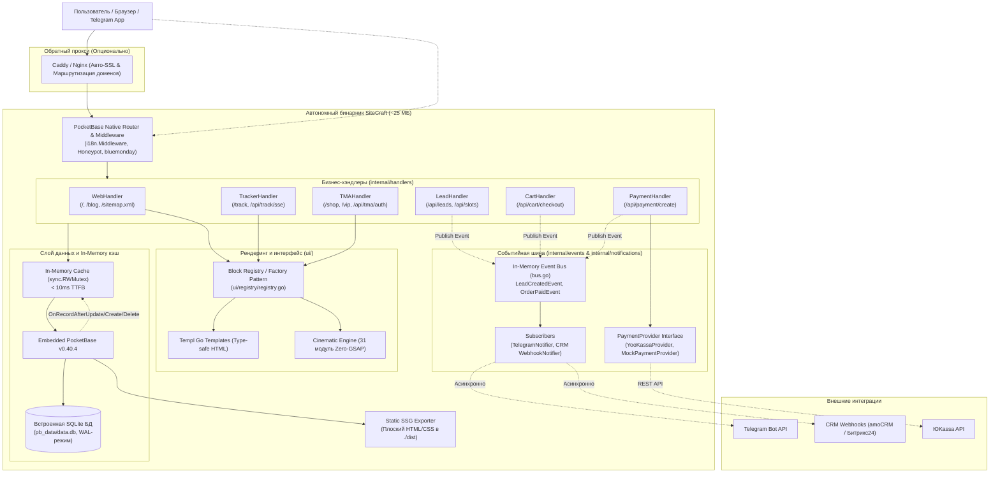

# ⚡ SiteCraft Engine — Генеральная документация проекта

> **SiteCraft** — модульный масштабируемый движок и универсальный стартовый набор (Boilerplate / Starter Kit) для создания сверхбыстрых коммерческих сайтов, веб-приложений малого и среднего бизнеса (SMB), локальных сервисов и корпоративных порталов.
>
> **Текущий стек:** Go 1.27 + PocketBase v0.40.4 + Templ + HTMX + Alpine.js + Tailwind CSS v4.3 (Oxide)  
> **Дата актуализации:** Октябрь 2026 г.

---

## 📑 Содержание

1. [Обзор и ключевые характеристики](#1-обзор-и-ключевые-характеристики)
2. [Архитектура ядра и потоков данных](#2-архитектура-ядра-и-потоков-данных)
3. [Структура проекта](#3-структура-проекта)
4. [База данных и схема коллекций PocketBase](#4-база-данных-и-схема-коллекций-pocketbase)
5. [Модели данных Go](#5-модели-данных-go)
6. [Карта маршрутов и API эндпоинтов](#6-карта-маршрутов-и-api-эндпоинтов)
7. [In-Memory кэширование и реактивные хуки](#7-in-memory-кэширование-и-реактивные-хуки)
8. [Событийная шина и уведомления (Event-Driven Architecture)](#8-событийная-шина-и-уведомления-event-driven-architecture)
9. [Модуль интернационализации (i18n RU / EN)](#9-модуль-интернационализации-i18n-ru--en)
10. [Динамический Theming Engine и CSS-архитектура](#10-динамический-theming-engine-и-css-архитектура)
11. [Реестр компонентов (Block Registry / Factory Pattern)](#11-реестр-компонентов-block-registry--factory-pattern)
12. [Коллекция кинематографических модулей (Cinematic UI — 31 компонент)](#12-коллекция-кинематографических-модулей-cinematic-ui--31-компонент)
13. [Коммерческие бизнес-модули](#13-коммерческие-бизнес-модули)
14. [Каталог готовых пресетов (12 ниш)](#14-каталог-готовых-пресетов-12-ниш)
15. [CLI-утилиты и мультисайтовый оркестратор (Fleet of Binaries)](#15-cli-утилиты-и-мультисайтовый-оркестратор-fleet-of-binaries)
16. [Сборка, тестирование и продакшен-деплой](#16-сборка-тестирование-и-продакшен-деплой)
17. [Сравнение с аналогами и архитектурные компромиссы](#17-сравнение-с-аналогами-и-архитектурные-компромиссы)
18. [Руководство разработчика: добавление секций и безопасность](#18-руководство-разработчика-добавление-секций-и-безопасность)

---

## 1. Обзор и ключевые характеристики

| Параметр | Значение | Описание |
|---|---|---|
| **Форм-фактор** | Single Binary (~25 МБ) | Веб-сервер, SQLite БД, админка `/_/`, шаблоны Templ и ассеты скомпилированы в один файл |
| **Потребление памяти** | **20–35 МБ RAM** | Позволяет запускать до 50 изолированных сайтов на одном базовом VPS ($10/мес) |
| **Время отклика (TTFB)** | **< 10 мс** | In-Memory кэш с блокировками чтения `sync.RWMutex` |
| **PageSpeed Insights** | **95–100 / 100** | Полное отсутствие тяжелой клиентской гидратации; CSS < 20 КБ; ленивая загрузка виджетов |
| **Рантайм в продакшене** | **0 КБ Node.js / Python** | Стили и шаблоны компилируются заранее (`templ generate`, `tailwindcss --minify`) |
| **Доступность** | **ГОСТ Р 52872-2019** | Встроенный микро-модуль для слабовидящих на нативном Vanilla JS (< 1.5 КБ) |
| **UI-примитивы** | `shadcn-templ/v2` + `Lucide` | 100% типобезопасные кнопки, бейджи и векторные иконки без сырого SVG |
| **Интерактивность** | HTMX + Alpine.js | Нативная связка `hx-alpine-compat` для бесконфликтных динамических AJAX-свопов |

---

## 2. Архитектура ядра и потоков данных



---

## 3. Структура проекта

```
.
├── main.go                       # Точка входа: инициализация PB, CLI-команды apply-preset и export
├── go.mod / go.sum               # Модуль Go: PocketBase 0.40.4, Templ 0.3.1070, bluemonday, lucide
├── Dockerfile                    # Multi-stage сборка компактного дистрибутива Alpine Linux
├── docker-compose.yml            # Продакшен-контейнер с постоянным томом pb_data
├── fleet.sh                      # CLI-менеджер парка инстансов (создание, запуск, бэкап, экспорт)
├── init-project.sh               # Интерактивный визард создания нового проекта под нишу
├── internal/
│   ├── cache/
│   │   └── cache.go              # Потокобезопасный in-memory кэш (RWMutex) для настроек и контента
│   ├── data/
│   │   ├── collections.go        # Инициализация и авто-миграции 7 коллекций PocketBase
│   │   ├── hooks.go              # Хуки инвалидации кэша при изменениях в админке
│   │   ├── preset.go             # Парсинг и применение JSON-пресетов ниш
│   │   ├── queries.go            # SQL-запросы и выборки данных с fallback-логикой
│   │   └── schema.go             # Корневой загрузчик схемы данных
│   ├── events/
│   │   ├── bus.go                # Потокобезопасная внутрипроцессная шина событий (sync.RWMutex)
│   │   ├── events.go             # Типы событий (LeadCreatedEvent, OrderPaidEvent)
│   │   └── bus_test.go           # Юнит-тесты событийной шины
│   ├── exporter/
│   │   ├── export.go             # Статический генератор (SSG): выгрузка сайта в плоский HTML/CSS
│   │   └── export_test.go        # Тестирование экспорта
│   ├── handlers/
│   │   ├── routes.go             # Регистрация HTTP-роутов PocketBase
│   │   ├── web.go                # Хэндлеры главной, блога, карты, слотов и sitemap
│   │   ├── leads.go              # Прием заявок, валидация, honeypot, публикация событий
│   │   ├── cart.go               # Обработка заказов из корзины (Alpine.js cart)
│   │   ├── payment.go            # Интеграция с ЮKassa и Mock Sandbox
│   │   ├── tracker.go            # B2B-трекер заказов с SSE-стримингом
│   │   ├── tma.go                # Telegram Mini App: HMAC-SHA256 авторизация, витрина, VIP-клуб
│   │   ├── validation.go         # Серверная валидация телефонов, email и капчи
│   │   └── *_test.go             # Набор интеграционных и юнит-тестов
│   ├── i18n/
│   │   ├── i18n.go               # Ядро локализации: нормализация, T(), Plural(), OGLocale()
│   │   ├── catalogs.go           # Словари терминов (навигация, доступность, формы, ошибки)
│   │   ├── middleware.go         # Router Middleware: авто-определение языка гостя
│   │   ├── handler.go            # Эндпоинт переключения языка (/api/lang/{code})
│   │   ├── localize.go           # Утилиты локализации динамических данных из БД
│   │   └── i18n_test.go          # Тесты системы i18n
│   ├── models/
│   │   ├── content.go            # Структуры данных (SiteSettings, PageBlock, Lead, CartItem, etc.)
│   │   ├── seo.go                # SEO-структуры (MetaTags, OpenGraph, JSON-LD)
│   │   └── seo_test.go           # Тесты генерации метатегов
│   ├── modules/
│   │   └── payment.go            # Интерфейс PaymentProvider и реализация MockProvider
│   └── notifications/
│       └── notifications.go      # Асинхронные нотификаторы (Telegram Bot, CRM Webhooks)
├── presets/                      # 12 готовых JSON-пресетов коммерческих ниш
├── public/                       # Статические медиа-файлы документации
└── ui/
    ├── embed.go                  # //go:embed ассетов и стилей в бинарник
    ├── assets/
    │   ├── input.css             # Tailwind v4 CSS-first конфиг (@theme директивы)
    │   ├── styles.css            # Скомпилированный минифицированный CSS (~15 КБ)
    │   └── css/                  # Модульные стили (tokens, shadcn, animations, a11y)
    ├── components/               # Примитивы интерфейса
    │   ├── a11y_bar.templ        # Панель для слабовидящих по ГОСТ (Vanilla JS)
    │   ├── cart_drawer.templ     # Выдвижная корзина покупок (Alpine.js)
    │   ├── dynamic_block.templ   # Рендерер rich_text/html с санитизацией bluemonday
    │   ├── floating_contact.templ# Мульти-мессенджер виджет (WhatsApp + Telegram)
    │   ├── footer.templ          # Настраиваемый подвал
    │   ├── header.templ          # Шапка с переключателем тем, i18n и a11y
    │   ├── payment.templ         # Модалка онлайн-оплаты
    │   ├── ui_showcase.templ     # Витрина компонентов shadcn-templ + Lucide
    │   └── cinematic/            # 31 кинематографический модуль (Zero-GSAP)
    ├── layouts/
    │   ├── base.templ            # Корневой HTML-шаблон, инъекция тем, a11y, скрипты
    │   └── seo.go                # Рендеринг SEO-тегов в <head>
    ├── pages/                    # Страницы сайта (home, blog_list, blog_post, tracker, shop, vip)
    ├── registry/
    │   ├── registry.go           # Фабрика компонентов (Block Registry / Factory Pattern)
    │   ├── helpers.go            # Парсеры JSON payload блоков (Features, FAQ, Quiz, etc.)
    │   └── helpers_test.go       # Тесты парсеров payload
    └── sections/                 # Модульные секции лендинга (hero/, booking, services, etc.)
```

---

## 4. База данных и схема коллекций PocketBase

PocketBase использует встраиваемую SQLite в режиме WAL (Write-Ahead Logging). Схема автоматически инициализируется и мигрирует при запуске (`internal/data/collections.go`):

### 1. `site_settings` (Синглтон настроек)
Хранит глобальную конфигурацию сайта:
* `site_name` (text, req), `tagline` (text)
* `theme` (text) — цветовая тема (`legal`, `medical`, `auto`, `beauty`, `cyber`, `main`, etc.)
* `primary_color`, `accent_color`, `background_color`, `font_family` — динамические токены брендинга
* `enable_a11y` (bool) — включение панели для слабовидящих по ГОСТ
* `enable_alpine` (bool) — подключение рантайма Alpine.js
* `enable_turnstile` (bool), `turnstile_site_key`, `turnstile_secret_key` — Cloudflare Turnstile
* `telegram_bot_token`, `telegram_chat_id`, `webhook_url` — уведомления о лидах
* `yandex_metrika_id` (text) — счетчик аналитики
* `map_mode` (text) — режим карты: `lazy` (HTMX revealed), `iframe`, `static`
* `booking_mode` (text) — режим записи: `simple` (имя + телефон), `slots` (сетка времени)
* `enable_payment` (bool), `payment_shop_id`, `payment_secret`, `payment_sandbox` (bool) — эквайринг
* `enable_blog` (bool) — модуль статей и базы знаний
* `enable_tma` (bool) — поддержка Telegram Mini Apps
* `enable_tracker` (bool) — B2B-трекер заказов
* `enable_i18n` (bool), `default_lang` (text: `ru` / `en`) — мультиязычность
* `enable_floating_contact` (bool), `whatsapp_phone`, `telegram_contact` — плавающий мессенджер
* `enable_cart` (bool) — выдвижная корзина заказов
* `header_variant`, `footer_variant` — варианты раскладки шапки и подвала

### 2. `site_content` (Тексты и контакты)
* `hero_badge`, `hero_title`, `hero_subtitle`
* `owner_name`, `owner_title` (с обратной совместимостью с `notary_name`, `notary_title`)
* `phone1`, `phone2`, `work_hours`, `lunch_break`, `days_off`
* `address`, `address_sub`, `map_iframe`
* `photo` (file: png, jpeg, webp, svg, gif)

### 3. `page_blocks` (Модульный конструктор страниц)
Управляет набором и очередностью блоков главной страницы:
* `type` (text, req) — тип секции: `hero`, `cyber_hero`, `legal_hero`, `split_hero`, `schedule`, `services`, `booking`, `map`, `features`, `faq`, `steps`, `reviews`, `team`, `gallery`, `quiz`, `calculator`, `before_after`, `showcase`, `rich_text`, `html`, `cinematic_*`
* `title` (text) — заголовок секции
* `content` (text) — сырой HTML или текст (санитизируется через bluemonday)
* `order` (int) — порядковый номер рендеринга на странице
* `active` (bool) — флаг видимости
* `payload` (json) — структурированные данные секции (шаги квиза, карточки features, FAQ)

### 4. `services` (Каталог услуг и прайс-лист)
* `title` (text, req), `description` (text), `price` (text)
* `order` (int), `active` (bool)

### 5. `leads` (Заявки клиентов и лидген)
* `name` (text, req), `phone` (text, req), `email` (text)
* `source` (text), `booking_date` (text), `booking_time` (text)
* `status` (text: `новая`, `в работе`, `завершена`, `отклонена`)
* `payload` (json) — произвольные нишевые поля (марка авто, VIN, смета квиза, состав корзины)

### 6. `articles` (SEO-Блог, База знаний и новости)
* `title` (text, req), `slug` (text, req, unique)
* `excerpt` (text), `content` (editor)
* `cover_image` (file), `author_name` (text), `published_at` (text, формат `YYYY-MM-DD HH:MM` с поддержкой отложенной публикации)
* `is_published` (bool), `is_deleted` (bool, мягкое удаление в корзину), `deleted_at` (text, дата удаления)
* `views_count` (int), `seo_title` (text), `seo_description` (text), `tags` (text)

### 7. `service_orders` (B2B-трекер заказов в реальном времени)
* `order_code` (text, req, unique) — например, `SRV-4182`, `FIX-9021`
* `client_name` (text), `client_phone` (text)
* `item_title` (text, req) — например, «BMW X5 3.0d (х819ок123)»
* `current_stage` (text: `received`, `diagnostics`, `in_progress`, `ready`, `completed`)
* `total_amount` (number), `is_paid` (bool)
* `stages_history` (json) — массив объектов этапов `{stage, title, timestamp, comment, done}`
* `notes` (text)

---

## 5. Модели данных Go

Все структуры строго типизированы в пакете `internal/models`:

* `SiteSettings` — отображение настроек сайта с поддержкой фиче-тогглов.
* `SiteContent` — контентные поля главной страницы и контакты.
* `PageBlock` — блок страницы с поддержкой гибкого поля `Payload map[string]interface{}`.
* `FeaturesPayload`, `FeatureItem` — структурированные преимущества.
* `FAQPayload`, `FAQItem` — вопросы и ответы с поддержкой аккордеона.
* `StepsPayload`, `StepItem` — этапы выполнения работ.
* `QuizPayload`, `QuizStep`, `QuizOption` — многошаговый интерактивный калькулятор с расчетом стоимости.
* `BeforeAfterPayload`, `BeforeAfterItem` — слайдеры сравнения кейсов.
* `CartItem`, `CartCheckoutRequest` — товары в корзине и запрос оформления заказа.
* `Lead` — универсальная модель входящей заявки.
* `ArticleItem` — статья блога с метатегами для поисковой оптимизации.
* `ServiceOrder`, `OrderStageHistory` — трекинг сервисного тикета и прогресс-бар.
* `TMAUser` — верифицированный пользователь Telegram WebApp.
* `SEOMetaTags` — метатеги OpenGraph, Twitter Cards, Canonical, Alternate Hreflang и JSON-LD schema.

---

## 6. Карта маршрутов и API эндпоинтов

Все маршруты регистрируются на нативном роутере PocketBase в `internal/handlers/routes.go`:

| Метод | Путь | Хэндлер | Назначение | Формат ответа |
|---|---|---|---|---|
| `GET` | `/assets/{path...}` | `apis.Static` | Раздача статики (встроенная FS `ui.AssetsFS()`) | Binary / CSS / Images |
| `GET` | `/` | `webHandler.HandleHome` | Главная страница сайта (SSR Templ + Cache) | HTML (Text/html) |
| `GET` | `/blog` | `webHandler.HandleBlogList` | Каталог статей блога с живым HTMX-поиском | HTML |
| `GET` | `/blog/{slug}` | `webHandler.HandleBlogPost` | Страница статьи с инкрементом просмотров | HTML |
| `GET` | `/sitemap.xml` | `webHandler.HandleSitemap` | Динамическая XML-карта сайта для поисковиков | XML (application/xml) |
| `GET` | `/track` | `trackerHandler.HandleTrackerPage` | Форма поиска статуса заказа по номеру | HTML |
| `GET` | `/track/{code}` | `trackerHandler.HandleTrackOrder` | Карточка заказа, история этапов и оплата | HTML |
| `GET` | `/api/track/status/{code}` | `trackerHandler.HandleTrackStatusPartial` | HTMX-парциал карточки заказа для поллинга | HTML Partial |
| `GET` | `/api/track/sse/{code}` | `trackerHandler.HandleTrackSSE` | Серверный поток событий (Server-Sent Events) | SSE (text/event-stream) |
| `GET` | `/shop` | `tmaHandler.HandleShop` | Telegram Mini App каталог с MainButton | HTML |
| `GET` | `/vip` | `tmaHandler.HandleVIPClub` | Закрытый VIP-клуб с проверкой доступа | HTML |
| `POST` | `/api/tma/auth` | `tmaHandler.HandleTMAAuth` | HMAC-SHA256 авторизация сессии Telegram | JSON |
| `POST` | `/api/shop/checkout` | `tmaHandler.HandleShopCheckout` | Быстрый заказ через Telegram WebApp | JSON |
| `GET` | `/api/map-frame` | `webHandler.HandleMapFrame` | Ленивая загрузка интерактивной карты (HTMX) | HTML Partial |
| `GET` | `/api/slots` | `webHandler.HandleSlots` | Проверка свободных/занятых слотов времени | HTML Partial |
| `GET` | `/api/payment/modal` | `webHandler.HandlePaymentModal` | Модальное окно выбора способа оплаты | HTML Partial |
| `POST` | `/api/leads` | `leadHandler.HandleCreateLead` | Отправка формы заявки (с Honeypot и капчей) | HTML Partial |
| `POST` | `/api/cart/checkout` | `cartHandler.HandleCheckout` | Оформление заказа из корзины (Alpine.js) | JSON / HTML |
| `POST` | `/api/payment/create` | `paymentHandler.HandleCreatePayment` | Инициализация платежа ЮKassa / Mock Sandbox | JSON |
| `GET` | `/api/lang/{code}` | `i18n.HandleSetLang` | Переключение языка с установкой cookie и редиректом | HTTP 302 Redirect |

---

## 7. In-Memory кэширование и реактивные хуки

Для достижения отклика **TTFB < 10 мс** запросы не обращаются к диску на каждое открытие страницы:

1. **Кэш-хранилище (`internal/cache/cache.go`):**  
   Использует потокобезопасную структуру со счетчиками и блокировками `sync.RWMutex`:
   * Кэш настроек `site_settings`
   * Кэш контента `site_content`
   * Кэш каталога `services`
   * Кэш блоков страницы `page_blocks`
   * Кэш статей `articles`
2. **Автоматическая реактивная инвалидация (`internal/data/hooks.go`):**  
   Подписана на события ядра PocketBase:
   ```go
   collections := []string{"site_settings", "site_content", "services", "page_blocks", "articles"}
   app.OnRecordAfterCreateSuccess(collections...).BindFunc(...)
   app.OnRecordAfterUpdateSuccess(collections...).BindFunc(...)
   app.OnRecordAfterDeleteSuccess(collections...).BindFunc(...)
   ```
   Любое сохранение в админ-панели мгновенно и точечно сбрасывает соответствующий срез кэша.
3. **Время выборки настроек:** **0 мс (O(1) чтение из RAM)**.

---

## 8. Собтийная шина и уведомления (Event-Driven Architecture)

Для исключения жесткой связанности бизнес-хэндлеры не вызывают внешние сервисы напрямую:

1. **Внутрипроцессная шина (`internal/events/bus.go`):**
   * Потокобезопасная публикация событий через интерфейс `EventBus`.
   * Типы событий: `LeadCreatedEvent` (создание заявки/записи), `OrderPaidEvent` (успешная онлайн-оплата заказа).
2. **Подписчики (`internal/notifications/notifications.go`):**
   * **Telegram Notifier:** формирует форматированное HTML-сообщение в Telegram-чат администратора с полным составом полей `payload`.
   * **CRM Webhook Notifier:** выполняет асинхронный POST-запрос с JSON-телом заявки на внешний URL (amoCRM, Битрикс24, n8n, Make).
   * **Композитный паттерн (`CompositeNotifier`):** позволяет объединять произвольное число каналов уведомлений без блокировки HTTP-ответа посетителю.
3. **Платежный провайдер (`internal/modules/payment.go`):**
   * Интерфейс `PaymentProvider` с методами `CreatePayment` и `GetPaymentStatus`.
   * Поддержка продакшен REST API ЮKassa и встроенного Mock/Sandbox провайдера для локальной разработки и тестирования без денег.

---

## 9. Модуль интернационализации (i18n RU / EN)

Пакет `internal/i18n` обеспечивает полноценную двуязычную локализацию без внешних JS-зависимостей:

1. **Каскадный Fallback определения языка:**
   * GET-параметр запроса: `?lang=en` или `?lang=ru` (высший приоритет, сразу обновляет Cookie).
   * Браузерная Cookie: `site_lang` (срок жизни 1 год).
   * HTTP-заголовок браузера: `Accept-Language`.
   * Дефолтный язык сайта из настроек `site_settings.default_lang` (по умолчанию `ru`).
2. **Zero-JS переключатель языков:**  
   В шапку (`ui/components/header.templ`) встроен компонент `LanguageSwitcher()`, работающий как чистые ссылки на эндпоинт `/api/lang/{code}` с возвратом на исходную страницу по заголовку `Referer`.
3. **Каталоги терминов (`internal/i18n/catalogs.go`):**  
   Семантические ключи охватывают навигацию (`nav.*`), темы оформления (`theme.*`), доступность (`a11y.*`), кнопки (`btn.*`), бронирование (`booking.*`), трекер (`tracker.*`), блог (`blog.*`) и сообщения валидации форм.
4. **Правила плюрализации:**  
   Функция `i18n.Plural(ctx, count, one, few, many)` с корректной грамматикой для русского (1 день, 2 дня, 5 дней) и английского языков.
5. **SEO-интернационализация:**  
   Динамический тег `<html lang="...">`, OpenGraph `og:locale` (`ru_RU` / `en_US`) и теги поисковой оптимизации `<link rel="alternate" hreflang="...">`.

---

## 10. Динамический Theming Engine и CSS-архитектура

### 1. Архитектура Tailwind CSS v4 (Oxide)
* **Чистый CSS-first конфиг:** Все директивы и токены задаются в `ui/assets/input.css` через `@theme`. Файл `tailwind.config.js` полностью устранен.
* **Автоматическое сканирование:** `@source "../**/*.templ"` обеспечивает сборку только используемых утилит.
* **CSS Color Level 4:** Использование нативной функции браузера `color-mix()` для расчета теней, hover-состояний и приглушенных поверхностей.

### 2. Управление из админки PocketBase
При изменении `primary_color`, `accent_color`, `background_color` или `font_family` в `site_settings`, движок генерирует inline `:root` стили в `<head>`, мгновенно меняя бренд сайта без перекомпиляции CSS.

### 3. Сезонные темы и режим День / Ночь
Интерактивный переключатель в шапке сайта поддерживает:
* Базовые темы: `main`, `spring`, `summer`, `autumn`, `winter`.
* Вычисляемая математическая гармония: `harmonic` / `harmonic-night`.
* Светлый и темный режимы для каждой темы (`-day` / `-night`).
* Специальный режим для людей с особенностями цветовосприятия (`colorblind`).

### 4. Панель доступности (ГОСТ Р 52872-2019)
Микро-модуль на нативном Vanilla JS (< 1.5 КБ) в `ui/components/a11y_bar.templ`:
* 3 размера шрифта (`normal`, `large`, `xlarge`).
* 3 контрастные схемы (`black-on-white`, `white-on-black`, `blue-on-cyan`).
* Увеличение кернинга (межбуквенного интервала).
* Отключение фоновых картинок и тяжелых анимаций.

---

## 11. Реестр компонентов (Block Registry / Factory Pattern)

Диспетчеризация секций страницы вынесена в расширяемую фабрику `ui/registry/registry.go`:

```go
type BlockRenderer func(block models.PageBlock, ctx RenderContext) templ.Component

// Регистрация кастомного блока
registry.RegisterBlock("custom_block", func(b models.PageBlock, ctx registry.RenderContext) templ.Component {
    return MyCustomBlock(b.Payload)
})
```

### Встроенные типы блоков:
* `hero` — Главный экран с автоматическим выбором варианта (`classic`, `split`, `legal`, `cyber`).
* `cyber_hero`, `legal_hero`, `split_hero` — Явные варианты главного экрана.
* `schedule` — Контактная плашка с часами работы и телефонами.
* `services` — Сетка услуг с кнопками онлайн-записи и онлайн-оплаты.
* `booking` — Форма лидгена (простая или календарь с временными слотами).
* `features` — Сетка преимуществ с типобезопасными иконками Lucide.
* `team` — Карточки специалистов и врачей.
* `steps` — Пошаговый алгоритм работы (воронка доверия).
* `reviews` — Сетка отзывов клиентов с рейтингом.
* `faq` — Аккордеон часто задаваемых вопросов.
* `gallery` — Визуальная галерея работ и портфолио.
* `map` — Интерактивная карта (Яндекс Карты) с ленивой подгрузкой при прокрутке.
* `quiz` / `calculator` — Интерактивный опросник с расчетом сметы.
* `before_after` / `comparison` — Слайдер визуального сравнения результатов.
* `showcase` — Витрина примитивов `shadcn-templ`.
* `cinematic_*` — Модули кинематографической коллекции.
* `rich_text` / `html` — Произвольный HTML с очисткой через `bluemonday.UGCPolicy()`.

---

## 12. Коллекция кинематографических модулей (Cinematic UI — 31 компонент)

В директории `ui/components/cinematic/` собрана полная коллекция из **31 кинематографического компонента**, работающих по архитектуре **Zero-GSAP** (0 КБ сторонних тяжелых библиотек, нативный CSS + легкий Motion One < 4 КБ):

### 1. Scroll-Driven модули (10 компонентов)
1. `text_mask.templ` — Субпиксельный скраббинг маски текста.
2. `sticky_stack.templ` — Прилипающие карточки с IntersectionObserver.
3. `zoom_parallax.templ` — 3D-зум параллакс с разлетом элементов.
4. `horizontal_scroll.templ` — Плавный перевод вертикального скролла в горизонталь.
5. `continuous_scrub.templ` — Непрерывный скраббинг карточки и временной шкалы.
6. `sticky_cards.templ` — Стопка прилипающих карточек на чистом CSS.
7. `svg_draw.templ` — Анимация отрисовки векторного контура при прокрутке.
8. `curtain_reveal.templ` — Раздвигающиеся створки шторки (100dvh).
9. `split_scroll.templ` — Разнонаправленный скролл левой и правой колонок.
10. `color_shift.templ` — Динамическая смена темы оформления при скролле к секции.

### 2. Cursor & Hover модули (8 компонентов)
11. `cursor_reactive.templ` — 3D-наклон карточки (Tilt) и магнитная кнопка.
12. `accordion_slider.templ` — Горизонтальный аккордеон на чистом CSS flex.
13. `image_reveal.templ` — Слайдер сравнения «До / После».
14. `image_trail.templ` — Шлейф всплывающих карточек за курсором.
15. `flip_cards.templ` — 3D-переворот карточек на чистом CSS.
16. `magnetic_grid.templ` — Плитки сетки, отталкивающиеся от курсора мыши.
17. `spotlight_border.templ` — Радиальная световая подсветка границ карточек.
18. `drag_pan.templ` — Перетаскиваемый холст (Miro/Figma style).

### 3. Click & Tap модули (6 компонентов)
19. `view_transitions.templ` — Морфинг карточки в модальное окно через View Transition API.
20. `particle_button.templ` — Салют искр на Canvas при клике по кнопке.
21. `odometer.templ` — Накат цифр счетчика при появлении во вьюпорте.
22. `coverflow.templ` — Apple Coverflow карусель с 3D-перспективой.
23. `dynamic_island.templ` — Морфинг плашки уведомлений на Alpine.js.
24. `dock_nav.templ` — macOS Dock с плавным увеличением иконок при наведении.

### 4. Ambient & Auto модули (7 компонентов)
25. `text_scramble.templ` — Эффект декодирования символов («Матрица») на RAF.
26. `kinetic_marquee.templ` — Бесконечная бегущая строка с GPU-ускорением.
27. `mesh_gradient.templ` — Живой фон с плавающими цветными орбами.
28. `circular_text.templ` — Текст, непрерывно вращающийся по окружности вокруг иконки.
29. `glitch_text.templ` — Киберпанк RGB-глитч текста на чистом CSS.
30. `typewriter.templ` — Эффект печатающегося текста с мигающей кареткой.
31. `gradient_stroke.templ` — Контурный текст с бегущим градиентом.

---

## 13. Коммерческие бизнес-модули

### 1. B2B-трекер заказов в реальном времени (`/track`)
* Позволяет клиентам сервисных центров, СТО, мастерских и клиник отслеживать статус работ по уникальному номеру квитанции (`SRV-4182`).
* Реализован живой SSE-канал (`/api/track/sse/{code}`) для мгновенного обновления прогресс-бара без перезагрузки страницы.
* Встроенная возможность онлайн-оплаты счета через ЮKassa прямо со страницы отслеживания.

### 2. Telegram Mini Apps (TMA) & VIP-клуб (`/shop`, `/vip`)
* **Авторизация:** Проверка HMAC-SHA256 подписи строки `initData` через бота (`/api/tma/auth`).
* **E-commerce витрина (`/shop`):** Поддержка нативной кнопки Telegram `MainButton` для мгновенного оформления заказа.
* **Закрытый клуб (`/vip`):** Пейволл для продажи доступа к премиальным материалам, курсам и сообществам.

### 3. SEO-Блог и База знаний (`/blog`, `/sitemap.xml`)
* Статьи с поддержкой тегов, форматированного HTML-контента и подсчета просмотров.
* **Отложенная публикация (Scheduled Publishing):** Статьи отображаются на сайте только при `is_published = true && published_at <= time.Now()`. Для материалов с датой публикации в будущем выставляется статус «Запланирована».
* **Синхронизация кэша (PocketBase Cron):** Фоновый планировщик (`app.Cron()`) каждую минуту проверяет запланированные статьи и инвалидирует In-Memory кэш, автоматически публикуя материалы в назначенный срок.
* **Корзина (Soft Delete):** Удалённые материалы исключаются из публичной витрины блога и XML Sitemap, сохраняясь в базе с флагом `is_deleted = true`.
* Живой поиск по заголовкам и тегам через HTMX без перезагрузки страниц.
* Автоматическая генерация XML Sitemap по протоколу поисковых систем (включает только опубликованные актуальные статьи).

### 4. Клиентская панель управления (`/client`)
* **Авторизация:** Простой защищенный доступ для клиента с авторизацией по сессионной куке `sitecraft_client_auth` (пароль настраивается в `site_settings.client_admin_password`, по умолчанию `admin`).
* **Управление лидами:** Таблица входящих заявок, фильтрация по статусам (`новая`, `в работе`, `завершена`), смена статуса в 1 клик через HTMX, экспорт базы лидов в CSV (`/client/export/leads.csv`).
* **Редактирование контактов:** Управление телефонами, адресом, временем работы, соцсетями и реквизитами без правок кода.
* **Управление статьями и новостями блога:**
  * **Таблица публикаций:** Отображение заголовка, URL, даты, статуса (🟢 Опубликована, 🟡 Запланирована, ⚪ Черновик).
  * **Быстрый тоггл (1 клик):** Скрыть или опубликовать материал мгновенно через `POST /client/articles/toggle/{id}`.
  * **Визуальный WYSIWYG-редактор:** Форматирование текста через Quill.js в темной теме.
  * **Drag & Drop обложка:** Загрузка, предпросмотр и удаление изображения обложки на Alpine.js.
  * **Отложенный постинг:** Ввод точной даты/времени (`datetime-local`) с кнопками быстрых пресетов («Сейчас», «Завтра в 09:00», «Через 3 дня», «Через неделю»).
  * **Корзина (Soft Delete):** Вкладка «Корзина» со счетчиком удаленных статей, функциями восстановления (`POST /client/articles/restore/{id}`), окончательного удаления (`DELETE /client/articles/permanent/{id}`) и полной очистки (`POST /client/articles/trash/empty`).

### 5. Интерактивная веб-корзина (Web Cart Drawer)
* Корзина покупок на Alpine.js (`ui/components/cart_drawer.templ`) с подсчетом суммы, выбором количества и кнопкой чекаута.
* Оформление заказа через эндпоинт `/api/cart/checkout` с сохранением в таблицу `leads` и публикацией события в шину.

### 6. Плавающий мульти-мессенджер (Floating Contact)
* Компактный виджет быстрой связи в правом нижнем углу экрана (`ui/components/floating_contact.templ`).
* Прямой переход в диалог WhatsApp (`whatsapp_phone`) или Telegram (`telegram_contact`).

---

## 14. Каталог готовых пресетов (12 ниш)

Все пресеты хранятся в формате JSON в каталоге `presets/`:

| Имя файла пресета | Ниша бизнеса | Ключевые секции и особенности |
|---|---|---|
| `presets/legal.json` | Нотариус / Юридическое бюро | Классический официальный стиль, график работы, реестр нотариальных действий |
| `presets/legal-swiss.json` | Швейцарский юридический стиль | Строгий минимализм, кинематографический одометр `cinematic_odometer`, бегущая строка |
| `presets/legal-british.json` | Британский стиль адвокатуры | Глубокий бордовый тон, строгая типографика, консервативная респектабельность |
| `presets/legal-milano.json` | Итальянская элегантность | Теплая гармоничная гамма, карточки со световыми границами `cinematic_spotlight` |
| `presets/legal-corporate.json` | Корпоративный арбитраж & M&A | Темно-синяя B2B палитра, прилипающие карточки тарифов `cinematic_sticky_cards` |
| `presets/medical.json` | Медицинский центр / Стоматология | Доверие, врачи, сертификаты, онлайн-запись по слотам времени |
| `presets/auto.json` | Автосервис / СТО / Детейлинг | Прайс-лист ТО, гарантия 12 месяцев, B2B-трекер готовности авто |
| `presets/repair.json` | Сервисный центр электроники | Диагностика, склад оригинальных запчастей, отслеживание ремонта техники |
| `presets/beauty.json` | Салон красоты / SPA / Барбершоп | Visual-First: галерея работ, каталог бьюти-мастеров, прайс-лист |
| `presets/cyber.json` | Киберпанк / Web3 / High-Tech | Неоновая темная эстетика, CyberHero, шрифт Bebas Neue, глитч-эффекты |
| `presets/delivery.json` | Доставка еды / Dark Kitchen | Меню блюд, карточки акций, корзина заказов с Telegram Mini App |
| `presets/academy.json` | Онлайн-курсы / EdTech / Академия | Программа курсов, лекторы, подписка на закрытый VIP-клуб резидентов |

---

## 15. CLI-утилиты и мультисайтовый оркестратор (Fleet of Binaries)

### 1. CLI-оркестратор парка инстансов (`fleet.sh`)

Скрипт предназначен для веб-студий и агентств, управляющих десятками изолированных клиентских сайтов на одном сервере (модель «1 клиент = 1 изолированный процесс + SQLite БД»):

```bash
# 1. Создать новый сайт клиента с автоматическим сидированием базы
./fleet.sh create auto-master --preset=auto --theme=auto --port=8091
./fleet.sh create dental-plus --preset=medical --theme=medical --port=8092

# 2. Управление фоновыми процессами
./fleet.sh start auto-master        # Запуск в фоне через nohup (PID сохраняется в app.pid)
./fleet.sh list                    # Мониторинг всех сайтов (SITE_ID, PRESET, PORT, STATUS, PID)
./fleet.sh restart auto-master      # Перезапуск процесса
./fleet.sh stop auto-master         # Остановка процесса

# 3. Генерация автономного бэкапа для передачи клиенту «под ключ»
./fleet.sh backup auto-master       # Создает архив backup_*.tar.gz со всей БД и медиафайлами

# 4. Экспорт инстанса в чистую статику (HTML/CSS)
./fleet.sh export auto-master ./dist-auto
```

### 2. Интерактивный визард сборщика (`init-project.sh`)

```bash
./init-project.sh
```
В интерактивном диалоге позволяет выбрать сферу бизнеса, тему, порт, учетные данные администратора, автоматически компилирует Templ, Tailwind v4, собирает Go-бинарник и инициализирует SQLite.

### 3. Прямые команды скомпилированного бинарника

```bash
# Обычный запуск сервера
./bin/sitecraft serve --http=127.0.0.1:8090 --dir=./pb_data

# Применение пресета на лету
./bin/sitecraft apply-preset medical --theme=medical

# Экспорт сайта в плоский HTML/CSS для GitHub Pages, Cloudflare Pages или S3
./bin/sitecraft export --out=./dist --preset=cyber
```

---

## 16. Сборка, тестирование и продакшен-деплой

### Локальная разработка и сборка

1. **Компиляция Templ шаблонов:**
   ```bash
   templ generate
   ```
2. **Компиляция стилей Tailwind CSS v4:**
   ```bash
   tailwindcss -i ui/assets/input.css -o ui/assets/styles.css --minify
   ```
3. **Сборка бинарника Go:**
   ```bash
   go build -ldflags="-s -w" -o bin/sitecraft .
   ```
4. **Запуск тестов:**
   ```bash
   go test ./...
   ```

### Развертывание в Docker

```bash
docker compose up -d --build
```
`Dockerfile` использует двухэтапную сборку (multi-stage):
1. Сборка артефактов в среде Go.
2. Финальный образ на базе минимального `alpine:latest` (размер контейнера ~35 МБ). Данные сохраняются в постоянном томе `pb_data`.

### Настройка обратного прокси Caddy (Авто-SSL)

```caddy
autoservice-pro.ru {
    reverse_proxy 127.0.0.1:8091
}

dental-premium.ru {
    reverse_proxy 127.0.0.1:8092
}
```

---

## 17. Сравнение с аналогами и архитектурные компромиссы

### 📊 Сравнительная матрица платформ

| Критерий | SiteCraft (Go + PB + HTMX) | WordPress (PHP + MySQL) | Tilda / Webflow (No-Code SaaS) | Next.js + Strapi (JS Fullstack) | Hugo / Zola (Статический SSG) |
|---|---|---|---|---|---|
| **Потребление RAM** | **~20–35 МБ** | 250–600 МБ | Облако (SaaS) | 350–800 МБ | 0 МБ (только веб-сервер) |
| **TTFB (отклик)** | **< 10 мс** | 150–500 мс | 100–300 мс | 50–150 мс | < 5 мс |
| **Сложность деплоя** | **1 бинарник** (или Docker) | LAMP/LEMP стек + плагины | 0 (кнопка в панели) | Node рантайм + БД + Redis | Статический хостинг (S3/Pages) |
| **Встроенная админка** | **Да (PocketBase)** | Да (тяжелая CMS) | Да (визуальный редактор) | Да (в Headless CMS) | **Нет** (нужен внешний Git/CMS) |
| **Стоимость хостинга** | **$0** (до 50 сайтов на VPS $10) | $5–15/мес за сайт | $12–25/мес за сайт | $15–30/мес | ~0$ |
| **Контроль над данными** | **100% On-Premise (SQLite)** | 100% On-Premise | 0% (Vendor lock-in) | 100% On-Premise | 100% On-Premise |
| **Zero-JS фундамент** | **Да (HTMX + нативный HTML)** | Нет (JQuery + плагины) | Нет (тяжелые бандлы) | Нет (гидратация React/Vue) | Да |
| **PageSpeed** | **95–100** | 50–80 (без тюнинга) | 60–85 | 85–95 | 98–100 |

### 🌟 Ключевые преимущества SiteCraft
1. **Экстремальная плотность размещения (Host Density):** Благодаря расходу ~25 МБ RAM на сайт, на сервере 2 ГБ RAM комфортно работают **40–50 изолированных сайтов** клиентов с собственными админками и базами данных.
2. **Простота резервного копирования:** Вся база данных SQLite и медиафайлы хранятся в одной директории `pb_data`. Бэкап — это мгновенная архивация одной папки через `./fleet.sh backup <site-id>`.
3. **Безупречный PageSpeed 100:** Нет гидратации клиентского виртуального DOM; CSS весит ~15 КБ; ленивая загрузка карт и виджетов через HTMX (`hx-trigger="revealed"`).
4. **Строгая типизация Go и Templ:** Ошибки рендеринга и несовпадения полей отлавливаются на этапе компиляции, а не в продакшене.

### ⚠️ Ограничения и компромиссы
1. **Отсутствие визуального Drag-and-Drop:** Контент наполняется через типизированные поля админки PocketBase, а не перетаскиванием блоков мышкой в браузере.
2. **Масштабирование SQLite:** Архитектура идеальна для коммерческих лендингов, каталогов и сайтов услуг до 1–2 млн визитов в месяц. Для высоконагруженных порталов с тысячами одновременных транзакций записи потребуется переход на клиент-серверную БД (PostgreSQL).

---

## 18. Руководство разработчика: добавление секций и безопасность

### Как добавить новую секцию страницы (Block Registry):

1. **Создайте шаблон секции** в папке `ui/sections/<my_section>.templ`:
   ```templ
   package sections

   templ MySection(title string, items []string) {
       <section class="py-16 bg-surface">
           <div class="max-w-6xl mx-auto px-4">
               <h2 class="text-3xl font-bold text-content">{ title }</h2>
               <!-- Содержимое -->
           </div>
       </section>
   }
   ```
2. **Скомпилируйте шаблоны:** `templ generate`.
3. **Зарегистрируйте рендерер** в `ui/registry/registry.go`:
   ```go
   RegisterBlock("my_section", func(b models.PageBlock, ctx RenderContext) templ.Component {
       return sections.MySection(b.Title, ctx.Content...)
   })
   ```
4. **Добавьте блок в PocketBase:** Создайте запись в коллекции `page_blocks` с типом `"my_section"`, укажите `order` и активируйте флаг `active: true`.

### Безопасность и антиспам:
* **Honeypot:** Все формы лидгена содержат скрытое поле `<input type="text" name="company_website_url" tabindex="-1">`. При его заполнении ботом запрос моментально отклоняется с ошибкой 422.
* **XSS-Санитизация:** Любой произвольный HTML-контент из базы перед отдачей в браузер проходит обязательную очистку политикой `bluemonday.UGCPolicy()`, что гарантирует защиту от внедрения вредоносных скриптов.

---

## 19. Клиентский JavaScript Runtime и Архитектурные Антипаттерны

Вся клиентская JavaScript-инфраструктура SiteCraft подчинена жестким критериям: **автономный бинарник Go (~25 МБ), PageSpeed 100/100, нулевая зависимость от внешних серверов/CDN и отсутствие Node.js рантайма в продакшене**.

Все скрипты физически расположены в `ui/assets/js/`, встроены в бинарник через `//go:embed all:assets` (`ui.AssetsFS()`) и отдаются веб-сервером напрямую.

### 📋 Реестр библиотек и зафиксированные версии

| Файл | Библиотека | Точная версия | Размер (gzip) | Назначение |
| :--- | :--- | :--- | :--- | :--- |
| `htmx.min.js` | **HTMX** | `4.0.0` | ~14 KB | Серверные AJAX-действия, SPA-переходы, подгрузка контента |
| `hx-alpine-compat.js` | **HTMX Alpine Extension** | `4.0.0` | ~1.5 KB | Сохранение состояния Alpine.js при HTMX DOM-свопах |
| `alpine.min.js` | **Alpine.js** | `3.17.4` | ~15 KB | Клиентская реактивность (модалки, бургер-меню, корзина, табы) |
| `alpine-mask.min.js` | **@alpinejs/mask** | `3.17.4` | ~0.9 KB | Маски ввода номеров телефонов (`+7 (999) 000-00-00`), дат и сумм |
| `motion.min.js` | **Motion One** | `10.18.0` | ~3.8 KB | Аппаратный скролл-скраббинг, шкалы прогресса, параллакс через WAAPI |
| `ogl.mjs` | **OGL (Minimal WebGL)** | `1.0.11` | ~39 KB | Кинематографические 3D-волны, интерактивные шейдеры, glTF-модели |
| `canvas-confetti.min.js`| **Canvas Confetti** | `1.9.4` | ~2.8 KB | Микро-салют при успешной конверсии (заявка, оплата заказа) |
| `quill.min.js` | **Quill.js** | `2.0.2` | ~45 KB | WYSIWYG-редактор статей блога в клиентском кабинете `/client` |

Суммарный объем базового JS-рантайма на странице составляет **< 35 КБ gzip** (без учета тяжелого редактора Quill, который изолирован внутри `/client`).

---

### 🚫 Реестр архитектурных антипаттернов (Запрещено в кодовой базе)

При добавлении новых секций, виджетов и интеграций **строго запрещено** нарушать следующие правила:

1. **❌ Запрет внешних CDN-скриптов (`unpkg.com`, `jsdelivr.net`, `cdnjs`):**
   * *Причина:* Риск отказа или замедления при сетевых сбоях, блокировках РКН; лишние DNS-lookup и TLS-рукопожатия; нарушение принципа 100% автономного дистрибутива.
   * *Правило:* Все зависимости сохраняются локально в `ui/assets/js/` и отдаются с хоста сайта.

2. **❌ Запрет тяжелых монолитных 3D-движков (Three.js, Babylon.js, Pixi.js):**
   * *Причина:* Three.js весит ~600 КБ (~170 КБ gzip), инициирует огромный WebGL-стек, занимает до 300 МБ RAM, сбивает PageSpeed до 60–80 баллов и вызывает краши в Telegram Mini Apps на бюджетных устройствах.
   * *Альтернатива:* Для шейдеров, волн и частиц — **OGL** (`ogl.mjs`); для товаров — Google `<model-viewer>`; для параллакса — CSS 3D.

3. **❌ Запрет GSAP (GreenSock) и ScrollTrigger:**
   * *Причина:* Вес > 65 КБ gzip, коммерческие лицензионные ограничения, постоянные слушатели скролла на главном потоке процессора (Main Thread).
   * *Альтернатива:* **Motion One** (`motion.min.js`, 3.8 КБ gzip) на базе нативного Web Animations API (выполняется на потоке GPU) + CSS `@keyframes`.

4. **❌ Запрет устаревших JS-комбайнов (Lodash, jQuery, Moment.js, Day.js):**
   * *Причина:* В ES2022+ есть все современные методы манипуляции массивами и объектами, а математика дат, слотов и валют решается на Go-бэкенде.

5. **❌ Запрет тяжелых библиотек графиков (Chart.js, ApexCharts, Highcharts):**
   * *Причина:* Оверхед 100–350 КБ ради пары статических графиков.
   * *Альтернатива:* Генерация чистого векторного SVG прямо в Go/Templ с серверным in-memory кэшированием.

6. **❌ Запрет создания утечек памяти при HTMX DOM-swaps:**
   * *Причина:* При удалении элементов через `hx-swap` таймеры (`setInterval`), циклы `requestAnimationFrame` и WebGL-контексты не очищаются сборщиком мусора автоматически.
   * *Правило:* Обязательная подписка на `htmx:beforeCleanupElement` для освобождения ресурсов (`gl.getExtension('WEBGL_lose_context')?.loseContext()`, `cancelAnimationFrame`).

---

*Документация составлена на основе полного аудита исходного кода репозитория SiteCraft.*
