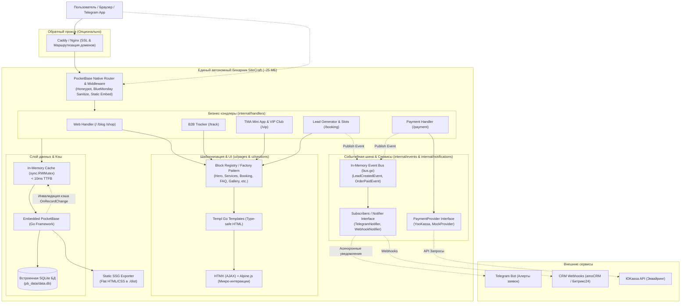
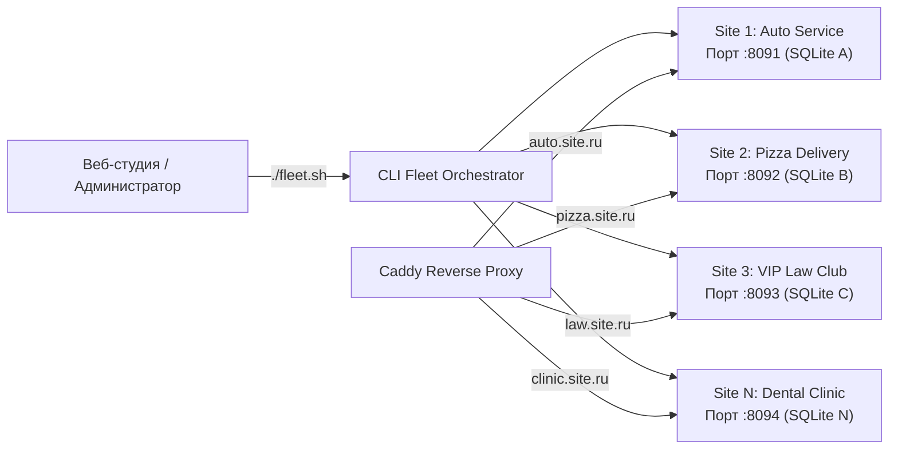

# ⚡ SiteCraft Engine & Starter Kit

**SiteCraft** — универсальный модульный движок и стартовый набор для создания сверхбыстрых коммерческих сайтов, каталогов услуг и лендингов малого и среднего бизнеса (SMB) на стеке **Go 1.27 + PocketBase + Templ + HTMX + Alpine.js + Tailwind CSS v4**.


-38bdf8?style=flat-square)

-purple?style=flat-square)
-blueviolet?style=flat-square)


---

## 🎯 Ключевые преимущества

1. **Единый автономный бинарник (~25 МБ):** Веб-сервер, база данных SQLite, панель управления (`/_/`), шаблоны и ассеты скомпилированы в один файл.
2. **Нулевой рантайм Node.js в продакшене:** Стили и шаблоны компилируются заранее при сборке.
3. **In-Memory Cache (sync.RWMutex):** Отдача страниц за **< 10 мс (TTFB)** с автоматической инвалидацией при редактировании данных в админке.
4. **Связка HTMX + Alpine.js (`hx-alpine-compat`):** 
   * **`hx-alpine-compat`** — нативная совместимость HTMX и Alpine.js при динамических DOM-свопах (автоматическая переинициализация реактивного состояния, модалок и форм без утечек памяти).
   * **Alpine.js + @alpinejs/mask** — мгновенные клиентские микро-интеракции (мобильное бургер-меню, маски номеров телефонов, корзина, календарь).
   * **HTMX** — серверные AJAX-действия без перезагрузки страниц (отправка заявок, lazy-loading карты, проверка занятых слотов, живой поиск).
5. **Дизайн-система `shadcn-templ` + `lucide-icons`:**
   * **`shadcn-templ/v2`** — типобезопасные компоненты кнопок (`@button.Button`) и бейджей (`@badge.Badge`) с вариантами (`Default`, `Secondary`, `Outline`, `Destructive`, `Ghost`), размерами и мостовыми токенами темы.
   * **`go-templ-lucide-icons`** — 100% типобезопасные векторные иконки без сырого SVG-кода.
   * **`tailwind-animations`** — плавные микро-взаимодействия (`animate-fade-in`, `animate-fade-in-up`, `animate-pulse-glow`, `hover:-translate-y-1`, `active:scale-[0.98]`) с автоматическим отключением в режиме доступности (`a11y-mode`) и `prefers-reduced-motion`.
6. **Динамический Theming Engine (управление цветами и шрифтами из PocketBase):** Возможность задавать `primary_color`, `accent_color`, `background_color` и `font_family` на лету из панели управления без пересборки Tailwind CSS!
7. **Модуль локализации i18n (RU / EN):** Полноценная многоязычность (`internal/i18n`) из коробки: определение языка через URL-параметр `?lang=`, Cookie или заголовок `Accept-Language`, Zero-JS переключатель языков, динамический `<html lang="...">`, `hreflang`, `og:locale` для SEO и локализованные сообщения валидации форм.
8. **Реестр компонентов (Block Registry / Factory Pattern):** Расширяемая модульная архитектура (`ui/registry/registry.go`). Любые новые секции легко регистрируются через `RegisterBlock(type, renderer)`. Включает встроенный блок `showcase` с витриной компонентов.
9. **Генератор статических сайтов (Static SSG Exporter):** Выгрузка сайта в чистый плоский HTML/CSS для бесплатного хостинга на GitHub Pages, Cloudflare Pages или S3.
10. **Оркестратор Fleet of Binaries (`./fleet.sh`):** Мультисайтовое развертывание для агентств и студий. 1 клиент = 1 изолированная база SQLite + личная админка. Потребление ~25 МБ RAM на сайт (до 50 сайтов на VPS за $10).
11. **Бизнес-модули "из коробки":**
    * **Клиентская панель управления (`/client`):** Автономный кабинет для владельца сайта: управление входящими заявками (статусы, экспорт CSV), редактирование контактов и реквизитов, визуальный WYSIWYG-редактор статей блога (Quill.js), загрузка обложек (Drag & Drop), отложенная публикация (Scheduled Publishing), быстрое скрытие в 1 клик и безопасное удаление через Корзину.
    * **B2B-трекер заказов в реальном времени (`/track`):** Отслеживание готовности авто/техники с живым SSE/HTMX обновлением прогресс-бара и онлайн-оплатой через ЮKassa.
    * **SEO-Блог и База знаний (`/blog`):** Экспертные статьи, живой поиск HTMX, автопубликация по расписанию через PocketBase Cron, динамический `sitemap.xml` и счетчик просмотров.
    * **Telegram Mini Apps (TMA) E-commerce & Paywall:** Запуск магазина (`/shop`) с нативной кнопкой Telegram MainButton, беспарольная авторизация HMAC-SHA256 и закрытый VIP-клуб (`/vip`).
    * Онлайн-оплата **ЮKassa** со встроенным Sandbox.
    * Панель доступности для слабовидящих по **ГОСТ Р 52872-2019** (микро-скрипт Vanilla JS < 1.5 КБ).
    * Интерактивная запись по слотам времени или простая лидген-форма.
    * Невидимый Honeypot для ботов и серверная XSS-санитизация через `bluemonday`.
    * Асинхронные уведомления в **Telegram Bot** и **CRM Webhooks** (amoCRM / Битрикс24).

---

## 🏛 Архитектура проекта

### 1. Архитектура ядра и потока данных (Engine Architecture)



### 2. Мультисайтовый парк (Fleet of Binaries)



---

## 🚀 Управление парком сайтов (Fleet of Binaries)

Для создания и обслуживания десятков клиентских сайтов используйте встроенный CLI-оркестратор [fleet.sh](fleet.sh):

```bash
# 1. Создать изолированный сайт клиента с нишевым пресетом
./fleet.sh create auto-service   --preset=repair   --theme=auto    --port=8091  # СТО с B2B-трекером заказов
./fleet.sh create pizza-craft    --preset=delivery --theme=warm    --port=8092  # Доставка еды + TMA корзина
./fleet.sh create vip-lawyers    --preset=academy  --theme=legal   --port=8093  # Закрытый VIP-клуб / курсы
./fleet.sh create dental-clinic  --preset=medical  --theme=medical --port=8094  # Стоматология с записью

# 2. Запуск и управление инстансами в фоне
./fleet.sh start auto-express
./fleet.sh list                 # Таблица статусов (SITE_ID, PRESET, PORT, STATUS, PID)
./fleet.sh restart auto-express
./fleet.sh stop auto-express

# 3. Экспорт сайта клиента в статический HTML/CSS
./fleet.sh export auto-express ./dist-auto

# 4. Резервное копирование и передача клиенту «под ключ»
./fleet.sh backup auto-express  # Создает автономный архив backup_*.tar.gz с базой SQLite и файлами
```

Подробное описание архитектуры читайте в **[FLEET_ARCHITECTURE.md](FLEET_ARCHITECTURE.md)**.

---

## 🎨 Динамический Theming Engine & Модульная CSS-архитектура

Движок поддерживает гибкую многоуровневую систему оформления:

### 1. Архитектура Tailwind CSS v4 (Oxide) & CSS Color Level 4
Проект работает на движке **Tailwind CSS v4 (Rust Oxide)** с чистой CSS-first конфигурацией без JavaScript-файлов настроек:
* **Конфигурация через `@theme` ([input.css](ui/assets/input.css)):** Все дизайн-токены регистрируются нативно через директиву `@theme`. Внешний `tailwind.config.js` полностью устранен.
* **Автоматическое сканирование `@source`:** Пути к шаблонам Templ (`@source "../**/*.templ"`) подключены напрямую в CSS.
* **Семантические токены ([tokens.css](ui/assets/css/tokens.css)):** Цвета объявлены в стандарте **CSS Color Level 4** с нативным браузерным расчетом вторичных оттенков через `color-mix()`.
* **Сверхбыстрая сборка (~70 мс):** Компиляция стилей происходит в 10 раз быстрее по сравнению с Tailwind v3.

### 2. Сезонные темы, Вычисляемая Гармония и режим День / Ночь
В шапку сайта ([header.templ](ui/components/header.templ)) встроен интерактивный переключатель (Alpine.js) с сохранением состояния в `localStorage`:
* **Базовые палитры:** Основная (`main`), Весна (`spring`), Лето (`summer`), Осень (`autumn`), Зима (`winter`).
* **Вычисляемая гармоническая тема (`harmonic` / `harmonic-night`):** математически рассчитанная палитра: второстепенные оттенки, поверхности, тени и акценты вычисляются на лету от главного тона.
* **Режим День / Ночь:** Мгновенное переключение между светлой и темной версией любой выбранной темы (`main-day`, `main-night`, `harmonic-night`, `winter-night` и т.д.).
* **Специальные режимы:** Режим для людей с особенностями цветовосприятия (`colorblind` / high-contrast) и нишевые пресеты (`cyber`, `legal`, `medical`, `auto`).

### 3. Управление палитрой из админки PocketBase (`site_settings`)
При указании базового `primary_color` или `accent_color` в панели управления, движок **автоматически вычисляет** через `color-mix()` всю цветовую шкалу бренда (hover-состояния, темные и светлые оттенки кнопок, тонированные фоны карточек) без пересборки CSS!

### 4. Дизайн-система shadcn-templ, Lucide и Tailwind Animations
Интерфейс построен на модульных и доступных примитивах:
* **UI-компоненты `shadcn-templ` ([ui/assets/css/shadcn.css](ui/assets/css/shadcn.css)):** Внедрены кнопки (`@button.Button`) и бейджи (`@badge.Badge`) с мостовыми классами `.cn-button`, `.cn-badge`, связанными с дизайн-токенами сайта и темами оформления (Dark, Light, Cyber, Harmonic).
* **Иконки `go-templ-lucide-icons`:** Единая типобезопасная коллекция векторных иконок для всех компонентов интерфейса. Никаких inline SVG-дубликатов.
* **Микровзаимодействия `tailwind-animations` ([ui/assets/css/animations.css](ui/assets/css/animations.css), [ui/assets/css/tw-animate.css](ui/assets/css/tw-animate.css)):** Плавные переходы, свечение бейджей `animate-pulse-glow`, всплытие списков `animate-fade-in-up`, модальные окна `animate-scale-in`, микро-лифт карточек (`hover:-translate-y-1 hover:shadow-md`) и тактильный отклик кнопок (`active:scale-[0.98]`).
* **Доступность из коробки:** Все тяжелые анимации автоматически отключаются при включении режима для слабовидящих (`body.a11y-mode`) или пользовательской настройки ОС `prefers-reduced-motion: reduce`.

---

## 🧩 Реестр компонентов (Block Registry)

Архитектура рендеринга секций построена на паттерне Factory / Registry в [ui/registry/registry.go](ui/registry/registry.go):

```go
// Регистрация кастомного блока (плагина)
registry.RegisterBlock("video_banner", func(b models.PageBlock, ctx registry.RenderContext) templ.Component {
    return components.VideoBanner(b.Payload)
})

// Готовый блок витрины UI компонентов shadcn-templ + Lucide
registry.RegisterBlock("showcase", func(b models.PageBlock, ctx registry.RenderContext) templ.Component {
    return components.UIShowcase()
})
```

Все блоки страницы упорядочиваются и настраиваются через коллекцию `page_blocks` в админке PocketBase.

---

## 🌍 Модуль интернационализации и локализации (i18n RU / EN)

Движок оснащен встроенным модулем локализации (`internal/i18n`), поддерживающим русский (`ru`) и английский (`en`) языки:

```
internal/i18n/
├── i18n.go         # Ядро: нормализация локали, извлечение из запроса, контекст, T(), Plural(), OGLocale()
├── catalogs.go     # Словари переводов (навигация, темы, a11y, кнопки, расписание, ошибки, футер)
├── middleware.go   # PocketBase Router Middleware (детекция языка, запись cookie site_lang)
├── handler.go      # HTTP-хэндлер переключения языка (/api/lang/{code}) с редиректом
├── localize.go     # Хелперы локализации динамического контента и услуг
└── i18n_test.go    # Модульные тесты для всех компонентов локализации
```

### Возможности модуля:
1. **Каскадное определение языка запроса (Fallback Cascade):**
   * Параметр строки запроса: `?lang=en` или `?lang=ru` (высший приоритет, сразу обновляет Cookie).
   * Cookie браузера: `site_lang` (хранит выбор пользователя в течение 1 года).
   * HTTP-заголовок `Accept-Language`: автоматический выбор предпочтительного языка гостя.
   * Дефолтный язык сайта из настроек `site_settings.default_lang` (по умолчанию `ru`).
2. **Zero-JS переключатель языков:** В шапку сайта ([header.templ](ui/components/header.templ)) встроен компонент `LanguageSwitcher()`, работающий как чистые HTML-ссылки `/api/lang/ru` и `/api/lang/en`. Работает мгновенно даже при отключенном JavaScript.
3. **SEO-интернационализация:**
   * Динамический атрибут `<html lang="{locale}">` в [base.templ](ui/layouts/base.templ).
   * Теги `<link rel="alternate" hreflang="ru" ...>` и `hreflang="en"`.
   * OpenGraph мета-тег `<meta property="og:locale" content="ru_RU" / "en_US">`.
4. **Локализованная валидация форм:** Ошибки отправки заявок (имя, телефон, капча/honeypot) возвращаются на языке текущего пользователя.
5. **Управление из админки:** Флаг `enable_i18n` (включение/отключение отображения переключателя) и `default_lang` в коллекции `site_settings`.

---

## ⚡ Событийная шина и слабая связанность (Event-Driven Bus)

Бизнес-хэндлеры не вызывают напрямую внешние сервисы. Вместо этого используется внутрипроцессная шина событий (`internal/events/bus.go`):

```go
// Публикация события заявки из любого модуля
eventBus.Publish(ctx, events.LeadCreatedEvent{
    Settings: settings,
    Lead:     leadModel,
})
```

* **Подписчики (`internal/notifications/notifications.go`):** Telegram-бот и CRM-вебхуки подписываются на события изолированно, не блокируя HTTP-ответ посетителю сайта.
* **Интерфейс `Notifier`:** поддерживает композитный паттерн (`CompositeNotifier`) для одновременной отправки в несколько каналов.
* **Интерфейс `PaymentProvider`:** абстрагирует платежные системы (ЮKassa, Тинькофф, тестовый Mock-провайдер) с внедрением зависимостей через опции конструктора `NewPaymentHandler`.

---

## 📦 Статический экспорт (Static SSG)

Вы можете использовать SiteCraft не только как серверное приложение, но и как генератор статики:

```bash
./bin/sitecraft export --out=./dist --preset=medical
```
Команда собирает оптимизированный `index.html`, минифицированные стили и все медиа-ассеты в папку `./dist`, готовую к размещению на GitHub Pages, Vercel, Netlify или Cloudflare.

---

## 🏗 Архитектура шаблонов и последовательность компонентов

В SiteCraft каждый пресет задает свою уникальную воронку конверсии и порядок секций:

| Ниша / Пресет | Стратегия воронки | Последовательность секций и компонентов |
| :--- | :--- | :--- |
| **Юридический / Нотариус**<br>`presets/legal.json` | **Легитимность и регламент:** официальный статус, расписание и правовые стандарты. | `Hero` → `Schedule` → `Features` → `Services` → `Steps` → `Booking` → `FAQ` → `Map` |
| **Юридический (Швейцарский стиль)**<br>`presets/legal-swiss.json` | **Строгий минимализм:** кинематографический счетчик `cinematic_odometer`, бегущая строка, сетка практик. | `Hero` → `Schedule` → `Odometer` → `Spotlight` → `StickyStack` → `StickyCards` → `Marquee` → `Booking` → `FAQ` → `Map` |
| **Юридический (Британский стиль)**<br>`presets/legal-british.json` | **Консервативная респектабельность:** глубокий бордовый тон, строгая типографика, классические кейсы. | `Hero` → `Schedule` → `Odometer` → `Spotlight` → `StickyStack` → `StickyCards` → `Marquee` → `Booking` → `FAQ` → `Map` |
| **Юридический (Миланский стиль)**<br>`presets/legal-milano.json` | **Итальянская элегантность:** теплая палитра, кинематографические карточки со световой границей. | `Hero` → `Schedule` → `Odometer` → `Spotlight` → `StickyStack` → `StickyCards` → `Marquee` → `Booking` → `FAQ` → `Map` |
| **Юридический (Корпоративный стиль)**<br>`presets/legal-corporate.json` | **B2B Арбитраж & M&A:** строгий темно-синий акцент, интерактивные дорожные карты защиты бизнеса. | `Hero` → `Schedule` → `Odometer` → `Spotlight` → `StickyStack` → `StickyCards` → `Marquee` → `Booking` → `FAQ` → `Map` |
| **Медицинский центр**<br>`presets/medical.json` | **Доверие к врачам:** оборудование, профильные врачи и подготовка к анализам. | `Hero` → `Features` → `Services` → `Team` → `Booking` → `Reviews` → `FAQ` → `Schedule` → `Map` |
| **Автосервис / СТО**<br>`presets/auto.json`, `presets/repair.json` | **Прайс-лист, быстрый лидген и B2B-трекер:** прозрачные цены на ТО, гарантия 12 месяцев. | `Hero` → `Services` → `Booking` → `Features` → `Steps` → `Reviews` → `FAQ` → `Map` → `Schedule` |
| **Салон красоты & SPA**<br>`presets/beauty.json` | **Visual First (Эстетика):** портфолио работ, бьюти-меню и карточки топ-мастеров. | `Hero` → `Gallery` → `Services` → `Features` → `Team` → `Reviews` → `Booking` → `FAQ` → `Map` |
| **Киберпанк & Web3**<br>`presets/cyber.json` | **Futuristic Experience:** темная high-tech эстетика, CyberHero, шрифт Bebas Neue. | `CyberHero` → `Features` → `Services` → `Booking` → `FAQ` |
| **Доставка еды / Dark Kitchen**<br>`presets/delivery.json` | **Food E-commerce & TMA:** меню, акции, онлайн-корзина с интеграцией Telegram WebApp. | `Hero` → `Services` → `Features` → `Steps` → `Reviews` → `Booking` → `FAQ` |
| **Академия & Онлайн-курсы**<br>`presets/academy.json` | **EdTech & Paywall:** программа обучения, лекторы, подписка на VIP-клуб. | `Hero` → `Features` → `Services` → `Team` → `Steps` → `Reviews` → `Booking` → `FAQ` |

---

## 📊 Сравнение с аналогами

| Критерий | SiteCraft (Go + PocketBase + HTMX) | WordPress (PHP + MySQL) | Tilda / Webflow (No-Code SaaS) | Next.js + Strapi (Node.js Fullstack) |
|---|---|---|---|---|
| **Потребление RAM** | **~20–35 МБ** | 250–600 МБ | Облако (SaaS) | 350–800 МБ |
| **TTFB (отклик)** | **< 10 мс** | 150–500 мс | 100–300 мс | 50–150 мс |
| **Сложность деплоя** | **1 бинарник** (или Docker) | LAMP/LEMP стек + плагины | 0 (кнопка в облаке) | Node.js рантайм + БД + Redis |
| **Встроенная админка** | **Да (PocketBase)** | Да (тяжелая CMS) | Да (визуальный редактор) | Да (в Headless CMS) |
| **Стоимость владения** | **$0** (до 50 сайтов на VPS за $10) | $5–15/мес за сайт | $12–25/мес за сайт | $15–30/мес |
| **Контроль данных** | **100% On-Premise (SQLite)** | 100% On-Premise | 0% (Vendor lock-in) | 100% On-Premise |
| **Интерактивность UI** | **HTMX + Alpine.js** | jQuery / тяжелые плагины | Базовые виджеты | React/Vue гидратация |
| **PageSpeed** | **95–100** | 50–80 | 60–85 | 85–95 |

---

## 🛠 Быстрый старт одного сайта

### Интерактивная сборка
```bash
./init-project.sh
```
Скрипт предложит выбрать сферу бизнеса, тему оформления и учетные данные суперпользователя.

### Ручной запуск бинарника
```bash
./bin/my-site serve --http=127.0.0.1:8090 --preset=medical
```
* **Сайт:** [http://127.0.0.1:8090](http://127.0.0.1:8090)
* **Панель управления PocketBase:** [http://127.0.0.1:8090/_/](http://127.0.0.1:8090/_/)
  * **Логин по умолчанию:** `admin@local.dev`
  * **Пароль по умолчанию:** `admin123456`

---

## 🐳 Развертывание в Docker

```bash
docker compose up -d --build
```
Все данные (база SQLite и загруженные файлы) сохраняются в томе `pb_data`.

---

## 📚 Документация проекта

* **[PROJECT_DOCUMENTATION.md](PROJECT_DOCUMENTATION.md)** — Генеральная техническая документация проекта (архитектура, роуты, БД, модели, i18n, кэш, Theming Engine, модули, руководство разработчика).
* **[FLEET_ARCHITECTURE.md](FLEET_ARCHITECTURE.md)** — Архитектура мультисайтового парка инстансов (Fleet of Binaries), интеграция с Caddy/Nginx и экспорт статики.
* **[ui/components/cinematic/README.md](ui/components/cinematic/README.md)** — Каталог и спецификация 31 кинематографического компонента (Zero-GSAP).
* **[public/README.md](public/README.md)** — Спецификация медиа-ассетов документации.
