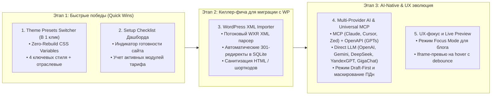

# 🚀 Дорожная карта интеграции передовых практик (UltimaPress & Ridu) в SiteCraft

В данном документе зафиксирован детальный план реализации, архитектурные решения, анализ рисков и стратегии обхода подводных камней для внедрения лучших практик из **UltimaPress** и **Ridu** в движок **SiteCraft (Go 1.27 + Templ + HTMX + Alpine.js + Tailwind CSS v4)**.

---

## 🧭 Матрица приоритетов и этапы внедрения



---

## 📌 Детальный план реализации по фичам

### 🎨 Фича 1: Theme Presets Switcher (Смена стиля в 1 клик)
**Приоритет:** Высокий | **Трудоемкость:** 1 день | **Статус:** Этап 1

* **Суть:** Мгновенная трансформация сайта между 4 глобальными стилями (*Modern Bright, Luxury Editorial, Dark Premium, Swiss Bold*) и отраслевыми пресетами без перекомпиляции Tailwind CSS.
* **Архитектурное решение:**
  * Использование структуры `ThemePreset` в пакете `internal/theme/presets.go`.
  * Инъекция CSS-переменных (`--color-primary`, `--color-accent`, `--font-heading`, `--font-body`, `--radius`) напрямую в корневой Templ layout.
  * HTMX-эндпоинт `POST /admin/api/theme/apply` с атомарным обновлением `site_settings` и инвалидацией in-memory кэша.
* **Подводные камни и решения:**
  * *Шрифтовой скачок (FOOC/FOUC):* Внедрить Zero-CDN локальные WOFF2-шрифты с `font-display: swap`.
  * *Потеря читаемости текста на кнопках:* Реализовать серверный расчет относительной яркости (Luminance check) по RGB для автоматического переключения `text-white` / `text-slate-900`.
  * *Случайная потеря настроек:* Сохранять предыдущую цветовую схему в сессии для возможности отката в 1 клик.

---

### ✅ Фича 2: Setup Checklist (Виджет готовности к запуску)
**Приоритет:** Высокий | **Трудоемкость:** 1 день | **Статус:** Этап 1

* **Суть:** Интерактивный виджет на дашборде админки, показывающий прогресс готовности сайта к запуску (контакты, оплата, Telegram-бот, метрика, каталог, 152-ФЗ).
* **Архитектурное решение:**
  * Пакет `internal/checker/checker.go` с функцией `EvaluateSiteHealth(settings, db) ChecklistResult`.
  * Рендер процентной шкалы и раскрывающегося списка незавершенных шагов с прямыми ссылками на соответствующие вкладки админки.
* **Подводные камни и решения:**
  * *Нагрузка на SQLite:* Кэшировать статус чеклиста в памяти и обновлять его только при событиях мутаций (EventBus).
  * *Раздражающие предупреждения о ненужных фичах:* Проверять только те модули, которые включены в текущем тарифе/конфигурации клиента через `AdminModule Registry`.

---

### 📦 Фича 3: WordPress XML Importer + 301-редиректы
**Приоритет:** Максимальный | **Трудоемкость:** 2–3 дня | **Статус:** Этап 2

* **Суть:** Бесшовная миграция клиентов со старых WordPress-сайтов с сохранением SEO-позиций и ссылочной массы за счет таблицы постоянных 301-редиректов.
* **Архитектурное решение:**
  * Новая миграция SQLite: таблица `redirects (id, source_path, target_path, status_code, created_at)` с B-Tree индексом по `source_path`.
  * Middleware в Chi с in-memory хэш-мапой для отдачи 301-редиректов за **0.1 мс**.
  * Потоковый XML-парсер `xml.NewDecoder` в `internal/importer/wordpress.go` для разбора стандартного WordPress WXR (`export.xml`).
* **Подводные камни и решения:**
  * *Мусорная верстка и шорткоды:* Конвейер очистки: регулярные выражения для удаления `[gallery]`, `[caption]` + санитизация через `bluemonday.UGCPolicy()`.
  * *Таймаут HTTP-запроса на больших сайтах:* Асинхронная обработка через фоновую горутину с трансляцией прогресса по SSE (`hx-ext="sse"`).
  * *Переполнение диска картинками:* Не скачивать все медиафайлы синхронно; использовать ленивую фоновую выкачку и конвертацию в WebP через `bimg` с ограничением частоты.

---

### 🤖 Фича 4: Мульти-провайдерный AI Engine & Universal MCP Server
**Приоритет:** Средний / Стратегический | **Трудоемкость:** 3–4 дня | **Статус:** Этап 3

* **Суть:** Универсальная интеграция с любыми современными ИИ-провайдерами, а не только с экосистемой Anthropic Claude:
  1. **Входящий протокол (Inbound Agent Connection):** 
     * **Model Context Protocol (MCP)** — открытый индустриальный стандарт, поддерживаемый Claude Desktop, Cursor, Zed, Windsurf, OpenCodeInterpreter, LibreChat.
     * **OpenAPI 3.1 / Function Calling Schema** — эндпоинт `/api/v1/agent/openapi.json` для подключения Custom GPTs (OpenAI), Gemini Extensions и автономных AI-агентов.
  2. **Исходящий прямой AI-клиент (Direct LLM Backend в админке SiteCraft):**
     * Модуль генерации/авто-написания контента и SEO-метатегов прямо внутри админки SiteCraft с поддержкой выбора провайдера:
       * **Anthropic** (Claude 3.5 Sonnet / Haiku)
       * **OpenAI** (GPT-4o / GPT-4o-mini)
       * **Google Gemini** (Gemini 2.0 Flash / Pro)
       * **DeepSeek** (DeepSeek V3 / R1)
       * **Отечественные LLM (для комплаенса в РФ):** **Яндекс GPT** и Сбер **GigaChat** (работают без VPN, зарубежных карт и соблюдают 152-ФЗ).
       * **Кастомные провайдеры (Custom / OpenAI-Compatible Endpoint):** Поддержка любых альтернативных шлюзов, агрегаторов и селф-хост решений (**anymodel.org**, OpenRouter, Together AI, Groq, Ollama, vLLM, LM Studio). Пользователь может указать в админке:
         * `custom_base_url` (например, `https://api.anymodel.org/v1`)
         * `custom_api_key`
         * `custom_model_name` (например, `llama-3.3-70b`, `qwen-2.5-72b` и т.д.)
* **Архитектурное решение:**
  * **Единый фасад провайдеров (`internal/ai/provider.go`):**
    ```go
    type LLMProvider interface {
        GenerateContent(ctx context.Context, prompt string, opts GenerateOpts) (string, error)
        GenerateSEO(ctx context.Context, text string) (SEOMeta, error)
        Name() string
    }
    ```
  * **Универсальный клиент `OpenAICompatibleClient`:** Так как **anymodel.org**, DeepSeek, OpenRouter, Groq и vLLM используют стандартный REST API `/chat/completions` от OpenAI, один и тот же переиспользуемый Go-клиент конфигурируется через кастомный `BaseURL`, кастомный `APIKey` и `ModelName`.
  * **Пресеты агрегаторов в UI админки:** Выпадающий список популярных шлюзов (OpenAI, Anthropic, DeepSeek, anymodel.org, Yandex, GigaChat, Custom) с автоматической подстановкой базового URL и возможностью ввести любой сторонний эндпоинт.
  * Настройка API-ключей в `site_settings` через админку (хранение в зашифрованном виде).
  * Сервер MCP по SSE (`/api/v1/mcp`) с набором типизированных инструментов, независимых от конкретной LLM.
* **Подводные камни и решения:**
  * *Разница в форматах Function Calling:* Провайдеры по-разному передают вызовы функций. Решение: MCP берет стандартизацию на себя на уровне входящего протокола, а для внутренних задач админки используется структурированный JSON Schema Output (`response_format: { type: "json_object" }`).
  * *Санкционные и сетевые блокировки зарубежных API:* Использование OpenAI или Claude из РФ часто требует прокси. Решение: встроенная поддержка HTTP-прокси в настройках провайдера (`proxy_url`) + нативная поддержка российских YandexGPT и GigaChat из коробки.
  * *Случайное удаление данных агентом:* Принцип **Draft First** — все создаваемые ИИ статьи, страницы и товары сохраняются строго со статусом `is_published = false`.
  * *Утечка персональных данных (152-ФЗ):* Маскирование номеров телефонов и email-адресов в ответах для внешних AI-моделей (`+7 (999) ***-12-34`).

---

### 🖥 Фича 5: UX-фокус и Live Hover Preview (Адаптация "The Spine")
**Приоритет:** Средний | **Трудоемкость:** 1–2 дня | **Статус:** Этап 3

* **Суть:** Внедрение лучших идей навигации UltimaPress без ломки проверенного мобильного сайдбара.
* **Архитектурное решение:**
  * **Focus Mode:** Кнопка перехода в полноэкранный режим редактирования статей блога (скрывает сайдбар, оставляя чистый Quill.js).
  * **Hover Preview:** Всплывающее превью статьи/страницы в таблице контента при наведении курсора с задержкой 400 мс (`@mouseenter.debounce.400ms`).
* **Подводные камни и решения:**
  * *Зависание вкладки от десятков iframe:* Использование синглтона превью-контейнера в Alpine.js: одновременно в DOM рендерится ровно один iframe, очищаемый при `mouseleave`.
  * *Тач-экраны:* Отключение эффекта ховера на смартфонах и планшетах через `@media (hover: hover) and (pointer: fine)`.

---

### ⚙️ Фича 6: Безопасный деплой и Fleet Hot-Reload (Альтернатива Deploy Key)
**Приоритет:** Инфраструктурный | **Трудоемкость:** 1 день | **Статус:** Этап 2

* **Суть:** Быстрое и безопасное обновление бинарников без разрыва соединений и без уязвимостей веб-интерфейса.
* **Архитектурное решение:**
  * Развитие CLI-оркестратора `fleet.sh`: команда `./fleet.sh update <client_id>`.
  * Двухэтапная сборка: компиляция нового бинарника -> проверка `--test-config` -> атомарная замена `mv sitecraft.new sitecraft` -> `systemctl reload`.
* **Подводные камни и решения:**
  * *Несовместимость схемы при откате:* Паттерн Expand/Contract для миграций goose (только обратная совместимость схемы) + обязательный снимок базы SQLite перед запуском обновления.

---

## 📅 График выполнения работ

| Спринт | Задачи | Результат |
| :--- | :--- | :--- |
| **Спринт 1 (1–2 дня)** | Фичи 1 и 2 (Theme Switcher, Setup Checklist) | Визуальная персонализация в 1 клик, наглядный аудит готовности сайта |
| **Спринт 2 (3–4 дня)** | Фичи 3 и 6 (WordPress Importer, 301 Redirects, Fleet Update) | Инструмент переезда с WP без потери SEO, атомарный перезапуск |
| **Спринт 3 (3–5 дней)** | Фичи 4 и 5 (Multi-Provider AI & MCP, Focus Mode & Hover Preview) | Универсальный AI-шлюз (Claude, OpenAI, Gemini, DeepSeek, YandexGPT, GigaChat) + MCP |
